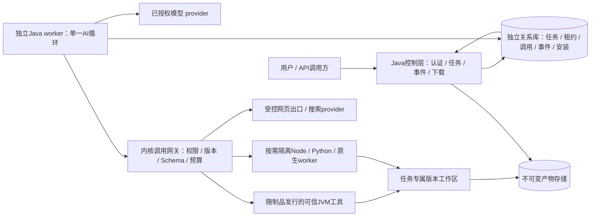

# 饕餮云端 AI 执行底座：可行性与总体方案

版本：0.3，统一审阅稿；日期：2026-10-15（北京时间）；事项：XIAO-33；合稿负责人：架构师；最终业务验收：产品经理。

本稿合并技术证据稿 0.2、工程规范草案 0.1、后端工具迁移证据稿研究 v1，并回应独立可测性审阅 v1、安全与性能审阅 v1。同步交付工程规范 0.2、工具迁移合稿 1.1 和统一迁移清单 1.1；旧分件保留为证据历史，其冲突设计不再作为实施依据。按工作区“PRD撰写”技能补齐目标、场景、边界、流程与可验证验收。结论为**有条件可行**，建议在文档审阅后先建立规范、骨架及门禁，再验证最小内核和一个真实任务。

当前交付是文档与静态证据。没有创建饕餮工程、编译 Java、运行 Harness/业务测试、部署服务或调用真实模型。所有接口、参数预算、状态机及验收均为待实施提案；父事项保持 `in_progress`。本稿未取得安全/性能独立审查通过，也不替代产品经理最终业务验收。

## 1. 业务目标、用户与首期范围

饕餮从零建立 Java 云端 AI 执行底座，让调用方把目标交给可治理的 Agent，通过真实工具完成任务，查看过程与失败原因，并获取可下载产物。它与女娲 AI 没有关系，不依赖其代码、工具、配置、数据、环境或服务。参考机制和全部基础工具以 DeepSeek Harness 固定源码为准。

“万物皆插件”落实为明确扩展点：模型、工具/连接器、技能、Agent/工作流、记忆/检索及运行/存储适配可以扩展；身份、租户授权、任务事实、预算、安装治理和最终准入仍由稳定内核负责。首期不以插件化口号增加插件市场、任意动态装包或多套编排。

| 使用者/场景 | 需要解决的问题 | 首期可观察结果 |
| --- | --- | --- |
| 提交公开主题的用户 | 搜集公开资料并形成可保存的报告；能辨认来源不足或失败 | 提交一次任务，看到真实检索/抓取/写入/发布过程，下载带来源的 Markdown 报告 |
| 接入底座的调用方 | 网络断开、重复提交或 worker 重启后仍能查询事实 | taskId、快照、事件游标和产物 API；重复受理不产生第二个任务 |
| 平台维护者 | 确认谁调用了什么、预算与失败发生在哪一步 | 关联身份/任务/调用的安全审计、版本与资源记录；凭据和正文默认不进日志 |
| 后续插件开发者 | 在稳定契约内迁移 Harness 工具，避免绕过治理 | manifest、公开接口、Schema、生命周期与共享契约测试；违规依赖/注册被门禁阻止 |

唯一首个业务纵切是**公开网页检索 → 网页获取 → 生成带来源报告 → 授权下载**。文件任务用于底层验收，不作为第二个同时承诺的业务 MVP。首期业务默认能力集合为 `web_search`、`web_fetch`、`read`、`write`、`present`；后三项支撑真实文件观察、写入与不可变产物发布。

总迁移范围包含固定目录中的全部 72 个注册项；分批实现不等于删减总范围。首期不开放任意 shell/代码、用户浏览器登录态、动态 npm/JAR 安装、外部写副作用、多 Agent 团队、复杂 Graph 或 RAG。它们保留在迁移矩阵，达到各自权限、依赖、隔离与行为门槛后再启用。

### 1.1 网页报告场景与关键流程

用户输入公开主题和必要的范围描述；服务端认证并建立 tenant/actor、工作区、能力、模型/插件版本及预算快照。主题不得携带 tenant、凭据、宿主路径或任意插件入口。

1. 持久受理后返回 taskId。用户看到排队/执行状态，连接断开不触发重复提交。
2. Agent 在授权集合内请求 `web_search`，用真实搜索结果确定候选来源；随后 `web_fetch` 获取内容，记录来源、抓取状态和截断事实。网页文字属于不可信数据，不能增加授权或改变执行规则。
3. 对任务报告路径先通过同一 FilePort 做真实观察。新文件记录“已观察不存在”；已存在文件记录版本。`read` 的缺失结果与已观察缺失事实分开表示，不能为了写入伪造一次成功读取。
4. `write` 经网关和强制观察/CAS 写入报告；目标已变、未观察或越界时拒绝，不以“生成报告”绕过文件规范。用户不需要处理运行机路径。
5. `present` 验证文件归属和版本，制作不可变快照，完成存储及元信息核验后登记、发布 artifact。之后才允许把业务任务记为成功；仅 write 成功或出现模型“已完成”文字均不算成功报告交付。
6. 用户经授权下载入口取得该快照。源文件之后变化不改变已交付报告；下载故障可重新获取同一 artifact，不重新运行模型或工具。

平台内部取证与文件底层步骤可以在简短过程摘要中显示。界面展示主题、状态、来源/局限、安全失败信息和产物；具体框架类、秘密引用、宿主绝对路径及隐藏思维不进入用户流程。

### 1.2 报告质量与成功条件

采用产品经理 2026-10-15 最新要求：报告包含**主题、摘要、结论、来源链接、生成时间和局限**；至少一个有效抓取来源；关键结论可追溯；部分失败必须披露。生成时间来自任务元数据，不虚构参考时间工具。

有效来源须有真实工具账本与成功抓取的可用正文。搜索摘要、未实际抓取 URL、页面错误正文、空页、仅登录提示或模型自行编造的链接，均不能独立满足“至少一个有效抓取来源”。非 2xx 页面仍按 Harness 语义作为可观察内容返回，但本业务不把它计为有效证据。

关键结论的引用链接必须关联本任务记录的有效来源。确定性检查可以验证引用成员关系、抓取事实和必要栏目；无法自动证明结论正确或引文蕴含关系。业务验收另用固定资料集人工核对关键事实、引文对应和局限披露，不声称换语言提高模型效果。

| 实际结果 | 任务行为与用户反馈 | 报告是否计成功 |
| --- | --- | --- |
| 至少一个有效抓取来源，栏目/追溯/产物发布均合格 | `SUCCEEDED`；来源与局限可见；授权下载可用 | 是 |
| 部分抓取/搜索失败，但剩余证据足以支撑明确限定的结论 | 可以 `SUCCEEDED`，报告必须说明失败来源/状态、未覆盖范围与不确定性，不能声称完整覆盖 | 满足其余条件才计成功 |
| 无搜索结果，或所有抓取均无有效证据 | `FAILED`，安全业务码 `NO_EVIDENCE`；展示查无证据及具体安全原因；允许用户修改范围重新提交 | 否；不交付“成功报告” |
| 缺 provider/鉴权失败、预算不足、写入冲突或发布失败 | 对应安全失败码；保留已确认来源、过程和安全诊断；不编造成功工具事件 | 否 |
| 用户取消/超时，执行或副作用未确认 | 取消意图/超时可见；必要时 `NEEDS_RECONCILIATION`，不能伪称全部停止 | 否 |

已登记的安全诊断产物可在失败任务中访问，但类型和界面明确为诊断，不记为成功报告。部分失败规则不能作为缺证据仍输出确定事实的许可。

### 1.3 初始运行边界

预算值是待实验的起始配置，不是已测性能或生产 SLA；实际有效上限取任务剩余预算、租户政策、安装预算和 provider 限制的最小值，且模型无法调大。

| 边界 | 起始提案/可检查行为 |
| --- | --- |
| 任务与模型 | 总 deadline 180 秒；最多 8 次模型请求、20 次工具准入；初始单次输出最多4096 token、输入上下文最多64 KiB、Schema集合最多64 KiB，provider不支持的请求约束须显式处理；不足时停止新准入 |
| 租户排队/并发 | 初始同时运行2个task、排队最多20个；准入/领取原子预留，恢复和取消核对释放；实验高并发须显式使用相应测试政策，不能无意关闭生产限制 |
| 网页工具 | 每次合作预算 30 秒，保留 Harness 部署默认线索；`web_search` 的 query 数、去重、并发和结果裁剪保持固定 Schema/实现；首任务最多抓取 8 个候选来源 |
| 网页输出 | 模型投影最多 200,000 字符（参考工具上限）；传输字节和解压后字节各初始上限2 MiB；HTML转换输入有界、与调用共享deadline，结果受manifest序列化字节限制；测试高压缩/慢响应，不能只在最终文本截断后声称内存有界 |
| 文件/报告 | 单份 Markdown 初始上限 1 MiB；每任务工作区初始上限 16 MiB；具体解码、读窗口及原子写语义以工具 fixture 为准 |
| 重试 | 宿主核验的暂时只读失败最多额外 1 次，受同一 deadline/次数/费用预算；SDK 自带重试纳入此预算；Agent、write/present 和未知副作用不盲重放 |
| 取消 | 持久化取消意图后立即阻止新准入；协作取消宽限初始 3 秒；隔离进程超宽限由 supervisor 终止整个进程树；可信 JVM 工具失控须回收 worker，不能硬杀线程冒充终止 |
| 租约/回收 | 初始租约 30 秒、每 10 秒续租；fencing token 随领取递增；测试允许注入 Clock/缩短时间，不用漫长 sleep 验证 |
| 发布/保留 | 暂存对象和发布记录可核对；初始未发布对象清理期限 1 小时、报告保留 7 天、下载凭证最多 5 分钟；保留/过期可测，实际策略由产品和资源约束确认 |
| 事件/订阅 | task事件初始保留7天；每actor/task最多2个订阅、每订阅队列最多64事件且256 KiB；慢消费者超限断开后按游标/快照恢复，不取消任务；游标早于首个保留seq返回410，超过最新seq拒绝为400 |

这些数量限制控制输入和资源，不保证远端网页/模型在期限内完成。任务 API 的 deadline 和运行预算不采用 SSE 连接超时替代。较大的工具输出在模型上下文预算内做有来源/截断标记的显式投影，不能以200,000字符的工具上限推定同等上下文可以全部发送。超出预算的输出不得静默截断成无局限说明的完整报告。

## 2. 参考证据与 Java 可行性

| 证据项 | 固定值与证据边界 |
| --- | --- |
| Harness | [官方固定提交](https://github.com/deepseek-ai/deepseek-harness/tree/571902028a75c64c1d767f4ae5fd099485f0ddf0)，SHA `571902028a75c64c1d767f4ae5fd099485f0ddf0` |
| 源码身份 | root `0.2.1-alpha.3`；Node `^22.19.0 \|\| >=24.0.0`，pnpm `11.28.5`；developer preview，可破坏兼容；SAFETY 明示未安全审计 |
| 许可 | Harness 第一方根 MIT，Copyright 2026 DeepSeek，复制/修改保留版权及许可；第三方闭包、浏览器/Office/模型服务条款另核，不把 root MIT 套用到所有依赖 |
| 工具目录 | 后端静态解析已提交 `docs/tool-catalog.md`，32 个包、72 个注册项、67 个不同工具名、34 个注册来源文件；未重新运行 catalog 生成器，不声称等于某一部署的全部实际可见工具 |
| 后端取证 | 来源 manifest 记录 682 个取得文件的 Git blob SHA-1、SHA-256 与字节数；不表示逐行审阅全仓，也不替代签名/供应链或运行验证 |
| 架构取证 | 技术证据稿和官方证据包包含固定架构、lifecycle、能力 seam、工具/会话、安装、sandbox/permission 及框架资料；失败读取项有记录，不用失败内容作行为依据 |

可借鉴：服务 provider/consumer 与可撤销注册、明确 turn/step 生命周期、输入输出与取消上下文、追加会话事实、单调执行 guard、受限能力发现。需要重做：云端 tenant/owner 边界、任务账本与恢复、租约/fencing、副作用核对、配额、独立工作区/不可变产物、网络与进程资源隔离。

Cordis/Node 插件不能原样加载到 JVM；Java 主要重写稳定契约与控制层，部分工具保留必要的受限 Node/Python/原生 worker 或协议适配。Harness 沙箱侧重文件效果且可能报告 partial，不能推定已解决云端网络、宿主挂载、秘密、多租户与内核隔离。

| Java 的实际收益 | 代价与平台仍需实现的能力 |
| --- | --- |
| record/接口/编译检查使内部状态与插件契约清楚；架构测试阻止依赖越界 | 模型/网络 JSON 仍需运行时 Schema 校验；静态类型不提高模型判断能力 |
| Spring/JVM 的认证、事务、连接池、观测、配置和测试生态便于统一维护 | 接入组件不等于 tenant 隔离、调度恢复、资源预算或 sandbox 已存在 |
| JDK21 虚拟线程可作为等待型并发任务的候选 | 不增加 CPU、连接池或外部 API 配额；JVM 启动/RSS/镜像和原生依赖有成本；吞吐须同条件实验 |
| 长期维护、版本契约、编译/静态/契约门禁适合多人协作 | 全部工具迁移、Cordis 生命周期改造、JS/浏览器/Office worker 运维与跟进 alpha 上游变化有持续成本 |

判定成立条件是治理与运行试验通过，不承诺仅换 Java 就自动获得安全、高性能、工具可靠性或更好模型效果。

## 3. 框架取舍与兼容边界

| 用途 | 候选组合 | 已核验的官方依据 | 未验证项 |
| --- | --- | --- | --- |
| 主选 | JDK21 / Boot4.1.1 / Spring AI2.0.1 | AI 正式 `v2.0.1` 固定提交 `c9107fdac0a6c88489c08bb88abcee74c146981d`；POM 的 Java 最低17、Boot4.1.1 | 本底座编译/依赖收敛、JDK21 实际兼容、模型与循环恢复；Boot 维护/安全补丁在实现前复核 |
| 备选 | JDK17 / Boot3.5.8 / Spring AI1.1.2 / Alibaba1.1.2.2 | Alibaba 正式 tag 固定提交 `7405a7dc0d66d582ec79430af6e24d259d5ca6ea` 及 POM | 本底座构建、Graph 持久化/中断与现行维护、安全修复依据 |

主选用一个 `ToolCallingAdvisor` 循环及 `ToolCallback` 适配，避免在首个单 Agent 任务叠两套编排。Alibaba 基于 Spring AI，并增加 Graph/Agent 模式；只有 E1 证明主选难以满足首期持久边界，或真实需求需要复杂图/人工中断且备选成本有证据时才切换。不能把 Alibaba1.x 与 AI2.x BOM 混配。milestone 或 Central 名称中的 `security-fix` 不代替正式兼容/维护证据。

| 能力 | 框架便利与实际差异 | 宿主职责 |
| --- | --- | --- |
| 模型、流式、工具 | Spring AI 提供模型抽象、stream/Advisor、DeepSeek starter、工具调用；Alibaba 使用基础抽象并增加 ReactAgent/Graph | 明确 endpoint/model/mode，限制每轮发现集合、Schema/预算、执行再鉴权；只维护一条主运行链 |
| Agent/工作流 | Spring AI 首期循环适用；Alibaba 图/中断/状态扩展可作备选 | task/attempt/lease、调用意图和结果持久化、可靠恢复与副作用账本，不能用 memory 代替 |
| MCP | 固定客户端文档含 STDIO/SSE/Streamable HTTP 等；Alibaba 接入其基础能力 | 具体 SDK/peer 共同协议版本、工具授权、远端身份与租户秘密、安装与运行治理；MCP 不等于 sandbox |
| 记忆/RAG | ChatMemory、仓库、VectorStore 及图状态可用 | memory 与完整历史分开；tenant/owner/resource 授权及 conversationId 分区；首期不强制向量库 |
| 观测 | Micrometer/Actuator、usage/工具观察 | 安全审计、预算、unknown usage、低基数指标；不把估算 usage 视作结算账单 |
| 许可/维护 | 两个框架第一方均 Apache2.0；准确依赖与通知按制品核验 | 版本收敛、升级/回退与 fixture 差异，模型服务和第三方条款另核 |

DeepSeek 当前文档出现 `deepseek-flash` 与不同协议/思考/strict 模式；固定 SDK 不必然支持所有最新模式。首期只验证一个明确 provider 配置，不把旧模型名或 fixture 当真实支持结果。当前滚动 MCP 规范 `2026-07-28` 与旧 SDK/peer 的共同能力仍待 E7 验证。

## 4. 最小架构、模块与执行边界



控制层与 Java worker 使用同一 Maven/Boot 制品的不同启动角色。首期是模块化单体控制层配独立执行 worker，不默认微服务、Kafka、向量库、负载均衡或 Kubernetes。先评估一套关系库领取任务与事实回放；消息只是唤醒，需要 broker 时才添加 outbox。数据库类型/驱动和存储资源在骨架前按实际绑定选择，不新建共享设施。

专用持久目录可以验证单节点存储适配；跨节点云端交付必须验证真实对象存储及授权。所有工作区、数据库、存储、provider 秘密由饕餮明确绑定的独立资源提供；未绑定资源影响实施，不阻断文档设计。

| 边界 | 不可绕过的规则 |
| --- | --- |
| 授权 | 认证建立 tenant/actor；发现只缩小已授权集合；每次实际执行含旧 callback、嵌套工具和内置工具均复核 |
| JVM 扩展 | 只允许审阅并随制品发布的可信代码；普通租户不能指定 class 或装 JAR；任意 JAR 动态加载不是沙箱 |
| 执行 worker | 非特权身份、专属目录、限制 CPU/RSS/PID/磁盘/输出/网络；禁止宿主 socket、秘密目录和用户本地登录态；未验证 runtime 拒绝对应能力 |
| 高风险代码 | 普通容器共享内核，不足以直接承诺敌对多租户隔离；按威胁模型验证强化 sandbox/VM 后开放 |
| 网页出口 | URL/协议/IP、DNS 所有答案、固定连接地址、重定向和云 metadata 拦截；代理路径必须由出口代理实际执行相同政策，不能拿直连检测作为代理保证 |
| 秘密 | 租户与调用级引用；优先由受控连接器代理持有；模型、manifest 明文、日志、SSE/报告不携带密钥 |
| 工作区 | task/tenant 专属根；真实文件打开边界防绝对路径、`..`、符号链接及检查后替换；normalize 字符串不等于隔离 |

## 5. 插件契约、样例与生命周期

插件是安装/版本管理单元，工具是可调用能力，一个插件可以声明多项工具；skill 是说明与资源，不能授予权限；Agent/工作流通过相同网关请求能力，不能直取凭据或 Repository。

### 5.1 统一 manifest 和结果形态

本稿统一 `entry.type` 的入口判别形式；不再把技术稿远程示例的 `transport` 与工程稿的 `type` 当两个可任意混用的规范。下面选择首期可信 Java `web_fetch`，是待实现设计样例，非上游 manifest。

首期以 `plugin.yaml` 作为manifest维护源，JSON注册视图由其生成，不另手工维护冲突定义。Schema源文件仍采用JSON。

```yaml
manifestVersion: 1
id: taotie.web.fetch
version: 0.2.0
kind: tool
hostApi: ">=0.1.0 <0.2.0"
entry:
  type: trusted-jvm
  class: io.taotie.plugins.builtin.webfetch.WebFetchPlugin
capabilities:
  - name: web_fetch
    inputSchema: input.schema.json
    outputSchema: output.schema.json
    sideEffect: read
permissions:
  network: [public-web-through-proxy]
secretRefs: []
dependencies: []
limits:
  timeoutMs: 30000
  outputBytes: 1048576
healthCheck: {operation: provider-readiness, timeoutMs: 2000}
errorContract: taotie-invocation-result
eventTypes: [invocation.started, invocation.completed, invocation.failed]
```

`trusted-jvm` class 只能来自宿主批准制品与发布注册表。改用隔离实现时使用 `entry.type: isolated-worker`、批准的 `runtimeRef` 与 `operation`；runtimeRef 解析到固定镜像摘要、身份、资源和协议，不能是任意 URL/命令。远程 MCP 使用批准 serverRef 与共同协议版本。准确可判别 Schema 与版本兼容由 P1 编译契约固定，不允许混合入口字段或隐藏降级。

Schema 固定 JSON Schema2020-12；包内文件引用须位于已校验包，不允许远程 `$ref`/路径逃逸，并限制大小、深度与校验成本。模型 Schema 子集显式转换或拒绝，服务端完整校验保留。`permissions`、`secretRefs` 和 `sideEffect` 是声明，不是自授权或安全重试依据；宿主 installation 才保存实际授予范围和已审核副作用分类。

```java
public record FetchInput(String url) {}
public record FetchOutput(int httpStatus, String sourceUrl,
                          String content, boolean truncated) {}
public interface ToolPlugin<I, O> {
  ToolDescriptor descriptor();
  Class<I> inputType();
  Class<O> outputType();
  ToolResult<O> execute(I input, ExecutionContext context);
}
```

输入 Schema 只允许必需 `url`；输出必需 `httpStatus/sourceUrl/content/truncated`。唯一权威输出源为本次附件 `XIAO-33-web-fetch-output-v0.2.0.schema.json`，打包的 `output.schema.json` 是其经哈希检查的派生副本，DTO/manifest/契约fixture均从同一源核对。插件示例升为 `taotie.web.fetch@0.2.0`，替代两份互不兼容的0.1.0草稿；旧草稿从未发布，没有已运行调用方或数据库迁移，但不得作为可安装版本。将来已发布输出破坏兼容时必须按版本规则发布新版本和明确映射，不改原版本。

canonical DTO采用 `httpStatus/sourceUrl/content/truncated`，不再同时采用简化的 `text/sourceUrl`。迁移投影仍保留上游模型端文本、来源、不可信标记和截断行为，不能把内部新字段静默当作上游原协议；公开事件只提供安全摘要，不直接序列化canonical正文。完整输入 JSON 示例与插件代码见工程规范0.2；上述尚未编译。

`ToolPlugin` 只依赖 `plugin.api` 和限权 provider 端口；`ExecutionContext` 由宿主构造，含授权作用域、取消/deadline、执行 token 和资源引用，不接受模型填写。模型 `ToolCallback` 只转换输入输出并委托 `InvocationGateway`。网关校验 tenant/task/actor、有效租约、安装 epoch、固定版本摘要、Schema、权限、预算和批准，再记录意图执行；没有特殊内置路径。

### 5.2 生命周期

1. 安装校验来源/摘要/API 范围、Schema、能力重名、依赖冲突/循环、批准的权限与入口；默认未激活，普通运行身份无权安装代码。
2. 启用先健康检查，再 CAS 更新 installation revision/epoch。发现缓存按 tenant/授权版本/installation revision 分区。
3. 禁用增加 epoch，阻止新准入和旧 callback 新调用；已准入调用按风险 drain/请求终止，不承诺撤销已有副作用。
4. 升级并存固定版本，新任务使用新版，在途任务 pin 摘要；紧急撤销可以阻断在途下一调用。可信 JVM 首期发布重启，不任意热加载。
5. 回滚只切新任务至已验证版本；状态格式采用兼容迁移，制品回滚不等于数据库回滚。
6. 有运行/产物引用的版本不删除；drain 后按归属回收。退订一个租户不能删除其他租户制品。

MCP 只负责互操作，不替代上述治理、预算、审计、取消或 sandbox。

## 6. 首期五工具的真实迁移与行为

全部取自同一 Harness 提交。每项第一方来源 MIT，源路径/完整输入 Schema 见附录 T 项与 JSON 清单；本表描述业务调用的关键行为与 cloud-v1 差异。

| 工具 | 上游调用与语义 | Java/云端路径与明确差异 | 验收 |
| --- | --- | --- | --- |
| web_search | tool-web → ctx.web → 配置 search provider；多 query 去重/并发/round-robin 裁剪，任一 provider 失败的整体失败按原语义保留 | Java/协议适配只选一个首期 provider；凭据与预算属 tenant；多次工具调用之间可以部分成功，不能把一次整体失败默改成成功 | 缺 provider/鉴权/429/取消/超时/空结果；输出来源真实；完整参数/结果 fixture；失败不伪造条目 |
| web_fetch | tool-web → ctx.web → web-fetch-http；非2xx返回可观察内容，HTML过滤/Markdown、不可信标记/截断；直连DNS及重定向有具体防护 | Java HTML 适配需金样；同源重定向默认最多5跳且每跳验证，跨源不自动跟随；出口代理相同政策；解压后字节限制 | SSRF、混合DNS/重绑定、IPv4映射/NAT64、跨源redirect、正文洪泛、非2xx/空页/取消；错误页不计有效报告证据 |
| read | tool-fs → ctx.fs；file_path/offset/limit，文本默认读窗口2000行；记录 observed 状态/版本与缺失事实 | 任务相对逻辑路径与限权 FilePort；保留缺失/分页/UTF8/取消；不把宿主路径暴露模型/用户 | 新目标不存在被真实观察；已有文件版本记录；越界/符号链接拒绝；缺失观察与成功内容不混同 |
| write | tool-fs → write-intent → 原子 writeText；file_path/content，允许空内容；上游观察策略可选 | 云端强制 observation/CAS；新文件用createIfAbsent，已有用replaceIfVersion；operationId绑定调用意图，落地前后记录版本；这是显式加强 | 未读/已变文件拒绝；空/Unicode；写成功后掉响应需核对；同operationId不重复覆盖，失败不伪成功 |
| present | tool-present 校验现存普通文件、会话/turn；成功最终 tools/result 后发布；上游不复制文件，UI查看当前源 | 云端改为不可变快照：绑定tenant/task/invocation/version/hash/size/mediaType，上传核验后登记/发布；不是把原宿主路径变成下载URL | 上传或最终工具结果失败不发布；重复发布幂等；源修改不改快照；他租户/过期链接拒绝；临时对象可清理 |

报告任务的 `write/present` 是受控内部副作用，依赖版本/operationId 和核对，不能因业务没有外部写就当作可任意重放的只读工具。持久恢复使用已确认工具结果与已登记快照，不重新生成/发布同一报告。

文件底层验收包括 `read/write/present` 的上述风险、FilePort 的 CAS/路径/容量/归属，以及每一新增文件工具的契约 fixture。后端原六工具文件任务中的 `edit/glob/grep` 在对应迁移批次接入后加入同一套件；不为网页 MVP 额外暴露 shell、rg 或第二个业务流程。`glob/grep` 保留固定原生 rg/argv/正则语义，与 FS 同工作区，不用 Java regex 静默替代；其进程清理测试在启用前必跑。

## 7. API、数据、状态及错误的统一口径

沿技术稿 API 提案，不强制新增大版本体系。下面是新底座设计，没有已上线旧调用方；未来兼容保留原 wire 名称和显式映射，不因 Java 类型重命名上游工具字段。

| API | 请求/响应与鉴权 | 失败与幂等 |
| --- | --- | --- |
| POST /api/tasks | Idempotency-Key；目标、授权资源/能力限制和预算；服务端建立身份；持久受理返回202、taskId/state | 同tenant/actor/key相同摘要返回原task；不同摘要409；参数400、认证401、配额429；不得把用户tenant字段当上下文 |
| GET /api/tasks/{id} | 授权快照、过程摘要、最终安全code、artifact列表 | 不可见统一404，不泄露他租户存在性 |
| GET /api/tasks/{id}/events | 授权SSE，以eventId/seq及Last-Event-ID恢复 | 重连只回放；游标过期410并读快照；不重启任务；token逐字流不作为可靠事实 |
| POST /api/tasks/{id}/cancel | 同权限，幂等持久记录取消意图；返回202或已终态快照 | 202不是已停止/副作用已撤销；取消与完成竞争以同库CAS事实决定 |
| GET /api/artifacts/{id}/download | 验tenant/task/owner、保留状态、发布快照；短期下载或代理传输 | 不返回宿主路径/storageKey；过期/不可见按安全政策失败；签名URL是短期bearer凭证，不写长期事件，强制即时撤权需求须采用代理下载 |
| 插件管理 | 平台/租户管理角色；预期revision，安装/启停/版本切换 | 冲突409；审计；普通task身份不能安装代码 |

### 7.1 标识与持久事实

统一使用 `invocationId` 表示工具调用；后端稿 `toolRunId/runId` 为同一概念的旧命名，迁移映射中说明，不另建一套运行表。session 是历史/上下文归属，task 是业务作业，attempt 是领取/恢复尝试，step 是模型/编排步骤；event.seq 在 task 内单调，artifact 归属生产调用及任务。

| 数据 | 归属、约束与访问模式 |
| --- | --- |
| session/task | tenant+owner/actor；task唯一tenant/actor/idempotencyKey及请求摘要；不可用taskId推定授权 |
| task_attempt | task/worker/leaseUntil/fencingToken/模型与插件快照；按readyAt领取和lease到期扫描，有对应索引 |
| step/invocation | attempt+ordinal唯一；调用意图、effectIntentId、固定插件摘要、输入/结果引用和状态；逻辑幂等键不随网络重试改变 |
| artifact | tenant/task/producerInvocation、不可变storageKey、hash/size/mediaType/version/保留期；发布前核验生产者及对象 |
| event | tenant/task/seq唯一、安全payload；状态与event同库事务提交，按task/seq有界回放 |
| installation | tenant/plugin/version、摘要、状态、revision/epoch、授予权限；管理状态与全局制品目录分开 |

Repository 显式带授权 tenant，子记录外键和约束含必要 tenant 维度；memory、缓存、MCP会话和连接凭据也不得仅按 endpoint/conversationId 跨用户复用。三个短事务分别处理任务受理、调用意图/预算预留、结果/事件提交；外部模型/网络/进程等待在事务外。产物上传非DB事务，采用暂存→核验→登记/发布→回收流程。

数据库迁移从独立 V1 开始，已发布脚本不修改，版本变更采用扩展/兼容读写/收缩；混合worker期间不破坏旧状态格式。资源/数据库尚未绑定，本轮没有 schema 或迁移实施。

### 7.2 状态与取消/未知结果

任务：`QUEUED → RUNNING → SUCCEEDED / FAILED`。取消先到 `CANCEL_REQUESTED`；执行停止且在途结果明确才 `CANCELLED`。任何副作用可能发生但无法确认的场景进入 `NEEDS_RECONCILIATION`，保留待核对操作与原因，不自动重放或报“已安全取消”。这不是正常成功终态，需后续核对后通过CAS收敛到最终事实。

invocation：`PENDING/RUNNING/SUCCEEDED/FAILED/CANCELLED/OUTCOME_UNKNOWN`；`OUTCOME_UNKNOWN` 是调用状态，对应宿主错误码 `EFFECT_OUTCOME_UNKNOWN` 和任务待核对状态。取消意图与具体工具 `CANCELLED` 不混同。

终态竞争以同库CAS提交顺序和实际效果为依据，不以浏览器收到的事件顺序判断：

| 当前事实/动作 | 允许后继及必要条件 |
| --- | --- |
| QUEUED收到cancel | 无执行租约/在途调用则同事务CANCELLED，释放预留并写事件 |
| RUNNING收到cancel | 原子写CANCEL_REQUESTED；此后阻止新准入。确认停止且效果已核对才CANCELLED |
| RUNNING提交成功 | 仅当前token、有效快照已发布、报告条件合格且未先受理cancel时CAS到SUCCEEDED |
| cancel意图先提交，随后工具/产物迟到 | 记录真实调用/产物事实，不覆盖取消意图报成功；停止/核对后CANCELLED，未知则NEEDS_RECONCILIATION |
| 成功/失败终态先提交，随后cancel | 幂等返回原终态，不把成功改成取消；已发布快照按保留政策可读 |
| deadline到期或普通失败 | 阻止新准入；确认本地执行及效果后FAILED及具体code；任何未确认副作用优先进入NEEDS_RECONCILIATION |
| 待核对取得实际状态 | 授权恢复协调、有效token和CAS确认效果，再收敛终态；默认不重新执行未知动作 |

取消、核对、配额释放和可靠事件在相应短事务更新；工具停止/产物上传本身仍在事务外。测试覆盖每个竞争顺序以及deadline/grace前、等于、后一时间单位。

| 分件候选/业务线索 | 本稿统一安全code | 规则 |
| --- | --- | --- |
| INVALID_ARGUMENT | INPUT_INVALID | Schema/参数/格式不合格，不执行 |
| PERMISSION_DENIED | ACCESS_DENIED | tenant/actor/能力/资源/批准不合格 |
| VERSION_CONFLICT、FS_NOT_OBSERVED/FS_STALE_VERSION | VERSION_STALE | 对外稳定分类；受限detail保留上游线索，不能覆盖或自动重试写 |
| PLUGIN_UNAVAILABLE | PLUGIN_DISABLED / DEPENDENCY_UNAVAILABLE | 安装禁用与provider缺失/网络问题分开 |
| OUTPUT_INVALID、RESOURCE_EXHAUSTED | OUTPUT_INVALID / RESOURCE_EXHAUSTED | 输出Schema与资源/预算分别记录，限额不放行 |
| DEADLINE_EXCEEDED、CANCELLED | DEADLINE_EXCEEDED / CANCEL_REQUESTED | 请求已取消与执行确认状态分开；已停止调用状态为CANCELLED |
| OUTCOME_UNKNOWN | EFFECT_OUTCOME_UNKNOWN | 停止自动重放并核对；不能只用retryable提示放行 |
| 无有效报告证据 | NO_EVIDENCE | 业务失败而非provider通用错误；不记成功报告 |
| INTERNAL | INTERNAL_ERROR | 外部安全摘要+traceId；受限内部诊断保留cause |

HTTP状态表达控制层受理问题，provider HTTP状态保存在canonical结果，工具code表达调用结果，任务code表达业务交付；四层不混同。web_fetch的404内容不等于工具调用失败，也不等于报告有效证据。

公开事件包含task/attempt/invocation、seq、type、安全摘要、duration、artifactIds、traceId和插件版本。插件只能提交进度/结果建议；可靠seq、artifact.created与task终态由宿主确认。事件不含完整参数、密钥、未脱敏URL query、正文或隐藏思维；重复/迟到事件不能把终态改回执行中。

事件envelope版本1：必需 `eventVersion/eventId/taskId/seq/type/occurredAt/status`；seq为正整数、occurredAt为UTC ISO-8601；attemptId/invocationId/pluginVersion/code/summary/traceId/artifactIds按事件类型提供。安全payload序列化上限初始64 KiB；artifact.created必须引用已登记快照，task.completed必须满足成功前置，type不允许插件任意制造可靠终态。示例：

```json
{
  "eventVersion": 1,
  "eventId": "evt_example",
  "taskId": "task_example",
  "attemptId": "attempt_example",
  "invocationId": "call_example",
  "seq": 17,
  "type": "invocation.completed",
  "occurredAt": "2026-10-15T00:00:00Z",
  "status": "SUCCEEDED",
  "code": "OK",
  "pluginVersion": "0.2.0",
  "summary": "已获取1个公开来源",
  "artifactIds": [],
  "traceId": "trace_example"
}
```

## 8. 持久恢复、副作用与运行治理

领取采用短事务条件更新/锁及递增 fencing token；记录worker/lease并原子预留配额。只有当前token能提交新结果/终态。旧worker返回保存安全诊断，不能覆盖现态；fencing不能阻止不支持token的远端已经发生副作用，仍须核对。

模型请求/完整响应、工具意图、成功响应和产物事实分别落库。SSE或模型token delta可以临时展示，可靠恢复只基于持久事实。E1必须证明主选循环的扩展点可以记录这些边界并从快照继续；ChatMemory并不证明任务可靠恢复。

恢复时已记录成功工具用原结果，不再次调用；未确认只读调用可在总预算内新attempt；write/unknown先按operationId/CAS、远端幂等状态或实际版本核对，无证据则待核对。控制层受理幂等不等于全部工具 exactly-once；禁止自动重放整个Agent。

批准绑定具体动作/对象/参数摘要/范围/有效期，参数变化重新判定。首期无外部写动作；将来消息发送、付费、浏览器操作、shell/脚本等必须有单独副作用账本和对账/取消语义。

成本按provider返回逐调用usage汇总，缺失记unknown/estimate，价格按时间/模型配置版本固定引用，不作为账单承诺。模型、发现、工具、排队/并发、工作区/产物和执行资源分别限额；崩溃/取消释放配额须有可恢复账本。

## 9. 工程规范先行

详细配套是本次附件《工程规范0.2》；本稿明确的manifest、错误/状态、阶段和门禁已同步至修订分件，0.1只保留历史证据。P1把主稿及配套规则版本化后编译验证，不能按旧分件任选一套。

```text
taotie/
  pom.xml / mvnw / mvnw.cmd / .mvn/wrapper/
  AGENTS.md / CONTRIBUTING.md
  src/main/java/io/taotie/
    bootstrap/                     # 角色启动、DI、配置，无业务
    api/                           # REST/SSE/下载与HTTP DTO
    kernel/{identity,task,plugin,invocation,artifact,event,budget,dispatch}/
                                   # 按需api/application/domain/port
    plugin/api/                    # 叶子契约、manifest、执行上下文
    model/api/                     # 稳定模型请求/响应/usage
    execution/                     # 单一AI循环、步骤持久化协调
    adapters/{ai/springai,persistence,storage,runtime,telemetry}/
    plugins/builtin/{websearch,webfetch,filesystem,present}/
  src/main/resources/{plugins/builtin,db/migration}/
  src/test/java/io/taotie/{architecture,kernel,contract,integration}/
  src/test/resources/contract/harness/<fixed-sha>/
  workers/                         # 有实际隔离工具时创建
  docs/{adr,migration,verification}/
  deploy/                          # 绑定真实目标后添加
```

首期单Maven项目、包边界及ArchUnit；plugin API需要独立发布或依赖隔离有证据时再抽制品，不预建空微服务。包名是建议样例，项目创建时统一确认；核内子目录按真实职责创建，不批量生成空Service/Manager。

| 模块 | 允许 | 禁止 |
| --- | --- | --- |
| plugin.api/model.api | JDK与批准轻量契约 | Spring AI/Alibaba、Controller、Entity、kernel/adapter实现、具体插件 |
| kernel.domain | 领域与ID值类型 | Spring/SQL、AI、具体插件与Controller |
| kernel.application/execution | 本域port、其他模块发布api、模型/插件契约 | 具体adapter/plugin、跨模块内部Service/Entity、直接工具body |
| api | 发布用例、HTTP DTO、身份映射 | 直连DB/工具/模型、创建执行线程 |
| builtin plugins | plugin契约、公开受限provider端口 | kernel内部、全局currentUser、任意Repository/秘密 |
| adapters/bootstrap | 实现port/装配具体实现 | 在adapter替代最终授权、bootstrap业务；其他模块反依赖bootstrap |

```java
noClasses().that().resideInAPackage("io.taotie.kernel..")
    .should().dependOnClassesThat().resideInAnyPackage(
        "io.taotie.plugins..", "io.taotie.adapters..",
        "io.taotie.bootstrap..", "org.springframework.ai..");
noClasses().that().resideInAPackage("io.taotie.plugin.api..")
    .should().dependOnClassesThat().resideInAnyPackage(
        "org.springframework..", "io.taotie.kernel..",
        "io.taotie.adapters..", "io.taotie.plugins..");
```

这是待编译规则示意，完整imports/version、真实类扫描、跨模块只用api、domain框架隔离、循环、危险进程/线程创建位置由P1落地。不能用空扫描通过当证明。

代码内容采用统一命名/Spotless导入格式、边界Schema/空值约定、HTTP DTO/领域/持久对象分离、构造注入/配置校验、显式不可变上下文、try-with-resources、短事务与单一重试政策。核心不能用任意Map/Object表达权限和状态；动态JSON只在有Schema及预算的协议边界，有界字符串labels是合理例外。禁止全局可变当前用户、硬编码凭据、吞异常后success或重复治理逻辑。

结构日志用time/level/role/trace/task/attempt/invocation/plugin/version/code/duration；不记秘密、原始prompt/完整响应/文件正文；高基数ID进日志/trace而非指标标签。状态事实与UI安全投影分开。

### 9.1 唯一交付门禁

```text
Windows: .\mvnw.cmd -B -ntp verify
Linux/CI: ./mvnw -B -ntp verify
本地格式修复: ./mvnw spotless:apply
```

`verify` 必须绑定Spotless、SpotBugs、Enforcer/BOM依赖收敛、ArchUnit、Surefire单元/契约、Failsafe必要集成、制品打包/角色启动。根据阶段实现范围运行真实受控DB/存储/worker；未实现功能无需空测试，已进入该阶段的关键集成不可依靠开发者自愿 `-Pworker-it`。缺Docker/DB等必需资源明确失败/阻断，不能silent skip宣称通过。

框架/插件准确工具版本由P1实际兼容后固定，保存effective POM、dependency tree、测试清单/退出码；不使用浮动/SNAPSHOT/milestone生产组合。每启用插件参加共享契约并生成真实注册catalog与Schema文档diff。依赖SBOM/许可按实际闭包核验，例外具体到artifact/规则/理由/owner/有效范围，不能全局关门禁。

负向证据必须证明：kernel导入具体插件失败；Controller直调工具/插件查DB失败；格式/import失败；重复工具名/坏Schema/不兼容manifest不激活；跨租户task/artifact拒绝；旧token提交终态拒绝。合法插件和修复后清洁构建须真实通过；故意违规只在测试分支/副本，不留生产源码。测试优先关键风险，不写纯DTO或静态内容镜像测试，不用“0项测试”当通过。

AGENTS.md和CONTRIBUTING引用同一规范；PR写触发/行为、契约差异、权限/副作用、真实验证与未验证项。框架、隔离、领取/fencing、插件兼容等关键取舍写ADR（问题/版本/决定/备选/影响/证据/回退），日常格式不强制ADR。上游更新固定新SHA、比较注册/Schema/provider行为、更新矩阵/fixture，不能构建时追master。

## 10. 分阶段实施与验收

统一采用P0–P5。分件S1对应P1；S2拆为P2内核试验与P3网页业务；S3/S4工具逐批迁移归P4，后批高风险项有启用门槛；P5是有真实需求/规模证据的新增产品能力。

| 阶段 | 前置与负责岗位 | 交付/退出条件 | 估量口径 |
| --- | --- | --- | --- |
| P0文档合稿/审阅 | 三份分件、清单与独立评审；架构合稿、产品最终业务判断 | 参考/框架/业务/工程/工具/验收一致；B1–B4文档闭合；评审阻断项明确 | 当前文档阶段，未计实现通过 |
| P1规范/骨架/门禁 | 产品审阅、真实目标绑定；后端实现、架构/测试核对、平台供环境 | 单制品角色、编译契约/样例、正反门禁、配置/独立迁移、真实依赖证据 | 约5–8人日，版本/环境准备影响较大 |
| P2最小内核/协议试验 | P1；后端/架构，测试独立证据 | E1/E3/E4基础：单一循环、账本、租约、授权、预算、SSE、产物和未知结果成立；框架正式锁定 | 与P3共享工作一起重估，避免同一治理重复计费 |
| P3网页报告真实纵切 | P2；真实模型/搜索/网页/存储合法连接及安全准入；后端/最小客户端/测试/产品 | W01–W08、F01相关底层、真实模型与搜索、授权下载、失败/恢复/取消均有证据；产品认定报告质量 | P2+P3暂估20–40人日，仅设计量级；不是旧六工具22–36人日原封套用 |
| P4全部工具逐批迁移 | P3稳定契约；后端/平台/测试按依赖，产品决定启用顺序 | 附录72项逐项完整Schema/行为/许可/cloud差异/权限/取消/回退/真实验收；延后项仍在总范围 | G包增量区间用于比较，不能乘每个T或直接求全量工期 |
| P5产品/规模扩展 | 使用/负载与明确业务证据 | 按需复杂编排、产品交互或更多资源治理；独立纵切/容量/安全证据 | 尚无规模，不给总工期或性能承诺 |

估量假设为一名熟悉Java的后端主开发，架构/平台/前端/测试按需协作；独立测试库/存储/worker可用、单一模型和搜索provider、简单客户端。未含资源采购、授权等待、全量安全审计、商业发布和上游变化；E1/P1后重估。G表是共享底座就绪后的整包增量，不与上述共享工作相加。新增规范/仓库绑定和资源等待不凭其他产品资产省略。

### 10.1 网页与文件验收基线（均未执行）

| 编号 | 输入/故障与操作 | 可观察断言/证据 |
| --- | --- | --- |
| W01正常报告 | 固定公开资料集/受控provider；另用合法真实provider记录独立实测 | 五工具真实账本；六栏目、至少一个有效抓取来源、关键结论追溯；不可变报告hash与下载一致；fixture和实测分开 |
| W02搜索契约/证据分支 | 多query/去重、一次search整体失败；零结果、全抓取失败/404/空正文，以及一个有效页与一个失败页 | 无有效证据FAILED/NO_EVIDENCE；部分失败披露且剩余证据合格才成功；上游非2xx内容和截断语义不偷偷改造 |
| W03不可信网页/输入 | 网页包含要求换tenant/读秘密/装工具；任意URL/SSRF/redirect及坏参数 | 不改变授权；危险出网/调用在真实执行边界拒绝，报告无秘密；有效来源判断独立 |
| W04授权/幂等/配额 | 两tenant及同tenant无权限actor猜task/artifact/history；相同key同/不同摘要，并发配额N−1/N/N+1 | 越权拒绝且下游请求计数0；同摘要同task、不同摘要409；配额原子预留/释放，无第二作业 |
| W05重复提交/恢复 | 相同key重试、SSE断线、worker在意图/结果/发布边界崩溃、旧token迟到 | 原task、seq回放、已成功调用不重放、只当前token提交；未知写结果待核对；重连不新增任务 |
| W06取消/预算 | 模型/搜索/抓取/写/发布各阶段取消或超限 | 无新准入；确认停止才CANCELLED；未知结果待核对；保留诊断、配额/临时资源回收 |
| W07产物/下载 | 上传失败、登记前后崩溃、源文件变化、错tenant/过期URL | 未核验发布不成功；快照不变、hash/size正确；访问拒绝；下载重试不重新执行任务 |
| W08版本/安装/provider | 插件禁用、旧callback、升级/回滚、模型/搜索鉴权故障 | 新准入按epoch拒绝，版本pin与安全撤销生效；稳定code/trace；无假成功 |
| F01文件底层 | F01-a为P3必跑：双工作区read/观察不存在→write→present；并发修改、Unicode/空文件/路径及符号链接竞态。F01-b为P4相应工具启用前：edit/glob/grep原始契约与取消 | a必须证明观察/CAS、operationId核对、路径/归属/容量拒绝及发布清理；b完成字面编辑、正则/分页/rg清理等。未完成b不得宣称六工具全套通过；文件不是第二业务MVP |

报告质量fixture断言和人工事实核对均有输入/预期来源，不要求任意外网结果逐字固定。真实模型验收给endpoint/model/mode、输入、调用/usage/工具/产物及失败证据，不把HTTP mock视为模型效果实测。

### 10.2 实验与准入门槛

| 实验 | 最小资源/验证问题 | 门槛与证据 |
| --- | --- | --- |
| E1主选构建/循环恢复 | 干净JDK21工程、锁定BOM、受控模型HTTP、一个真实managed工具；每个持久边界注入崩溃 | dependency tree/effective POM、call/stream/发现、可恢复请求/结果/意图；已成功工具不重放；失败则评估Graph备选再选一套 |
| E2真实模型/搜索 | 合法独立凭据；固定一个model/mode及search provider，真实公开页 | 基本/单工具/多步/流式返回、坏参数拒绝、真实来源和报告；与fixture分开；本轮未调用 |
| E3租户/预算 | 两tenant、不同凭据/目录/能力；受控工具并发、旧callback/撤权 | 发现、执行、历史、memory/连接、产物都拒越权；原子配额且崩溃回收 |
| E4恢复/产物/SSE | 一个控制角色、两worker、真实选定DB/存储；租约过期、掉响应/断流/迟到结果 | 唯一有效写者、事件回放、不会假成功/重复发布；未发布对象可核对清理 |
| E5运行/出网隔离 | 最小受控环境；路径竞态/秘密/metadata/DNS/redirect/输出洪泛/子进程 | 限制在实际执行边界生效；无孤儿/遗留写者；不合格能力拒绝准入，不降级到宿主 |
| E6副作用与取消 | fake支持/不支持幂等写服务、文件operationId；响应丢失、取消/完成竞争 | 支持时不重复；无确认时OUTCOME_UNKNOWN/待核对；不凭retryable重放，批准绑定参数 |
| E7生命周期/MCP | 两固定插件版本、坏Schema/冲突；可选固定peer | 禁用旧回调、pin/撤销、升级回滚；MCP共同协议及租户session/secret隔离；高级能力按需 |
| E8性能与预算基线 | 同机器/版本/数据/限额，受控模型，1/10/50等待型任务至少3轮；真实模型延迟另列 | 测排队/首事件/任务p50/p95、吞吐、RSS/CPU/启动、错误率、取消清理与费用；测得后经评审确定性能阈值，不把预期写成通过 |

安全边界是启用对应能力的前置，不等到“全量工具后”补做；通用容器、网络取消通知或JVM线程中断均不能单独构成通过证据。实验资源、命令、配置和结果须附原始证据与限制，缺必需资源不能silent skip。

## 11. 合稿修订与阻断项

B1–B4属于本轮可在文档闭合的项；“文档闭合”不表示运行验收通过。B5/B6作为后续实验准入，性能阈值在基线实验后决定。详细逐项对照随本稿另附《合稿修订与评审对照》。

当前阻断实施/验收的事实是：没有绑定真实代码/验收资源；主选循环/兼容尚未运行；真实模型/搜索尚未验证；执行/出网/副作用恢复尚未实验证明；独立安全/性能审阅v1的R1–R3已在本稿及配套文档修正，但尚待针对性复核。它们不阻断本轮完整文档交付，父事项继续in_progress，由产品经理安排复核并作最终业务判断。

本稿不新增部署/模型调用授权，不创建实现子事项，不重复派发已在进行的独立审阅。目标和工具来源已确定，不再询问来源或首场景。

## 12. 审阅基线与证据入口

| 分件/证据 | 已交付版本与入口 | 本稿用途 |
| --- | --- | --- |
| 技术证据 | [0.2](/api/attachments/01a13b71-d650-7a75-ab62-eaa4d851313a/download) | 固定参考/框架事实与来源；技术候选被本稿统一口径覆盖 |
| 工程规范 | [0.1](/api/attachments/01a13b71-d681-73a0-a22e-fc0c2b3042a1/download) | 目录、代码内容、插件完整样例、门禁与协作；以本稿修订口径执行 |
| 官方证据包 | [来源快照/索引/哈希](/api/attachments/01a13b71-d710-7c76-8515-23a6c57ad3cd/download) | 复核Harness及框架静态结论，不当运行结果 |
| 工具迁移 | [研究v1](/api/attachments/01a13b7b-80c0-7a8a-922d-b1c15bef2d82/download) | 32包依赖/权限/成本与72项逐项行为；本稿采用网页首期及统一阶段/门禁 |
| 完整工具Schema | [72项JSON](/api/attachments/01a13b7b-810a-747d-b881-b6f6ba3dd515/download) | 参数完整嵌套结构、注册来源和迁移映射；静态目录不是所有配置Schema全集 |
| Harness来源manifest | [682文件哈希清单](/api/attachments/01a13b7b-812f-7467-878b-414386b2cae9/download) | 核验注册来源和固定提交，未声称重新执行上游生成器 |
| 可测性审阅 | [v1](/api/attachments/01a13b82-974e-7a86-85c6-8d7b7edc33ce/download) | B1–B6、W/F与E门槛；本稿补齐后需针对性复核 |
| 安全/性能审阅 | [v1](/api/attachments/01a13b88-9e33-75ba-ab01-b08327155d18/download) | R1–R3文档阻断与后续资源/网络/取消实验；不是运行通过 |

框架官方固定入口：[Spring AI2.0.1 POM](https://github.com/spring-projects/spring-ai/blob/c9107fdac0a6c88489c08bb88abcee74c146981d/pom.xml)、[Alibaba1.1.2.2 POM](https://github.com/alibaba/spring-ai-alibaba/blob/7405a7dc0d66d582ec79430af6e24d259d5ca6ea/pom.xml)。Harness [LICENSE](https://github.com/deepseek-ai/deepseek-harness/blob/571902028a75c64c1d767f4ae5fd099485f0ddf0/LICENSE)、[tool-catalog](https://github.com/deepseek-ai/deepseek-harness/blob/571902028a75c64c1d767f4ae5fd099485f0ddf0/docs/tool-catalog.md)、[执行管线](https://github.com/deepseek-ai/deepseek-harness/blob/571902028a75c64c1d767f4ae5fd099485f0ddf0/docs/tool-execution-pipeline.md)。完整框架/协议引用见技术证据索引，未增加未读取的性能事实。

## 附录A. 全量工具迁移矩阵

下表从后端已交付JSON生成，保留G/T身份与固定来源；统一阶段以本稿为准。J=Java实现，P=协议适配，W=隔离worker，D=需要单独验证/延后或显式替代；D不表示取消迁移项。包级人日为底座就绪后的整包增量，不能再给每个T乘一次。全部项当前为规划，未迁移或运行。

<!-- TOOL_MATRIX_START -->
### A.1 包级迁移路径、权限与成本

| 包/工具 | 路径/统一阶段/整包增量人日/岗位 | 协议与真实依赖 | 权限/资源边界 | 该包各工具验收基线 |
| --- | --- | --- | --- | --- |
| G01 @deepseek-ai/dsh-plugin-manager<br>`plugin_manager` | J/管理面<br>P4后批，先验证启用条件；4–7；后端＋平台 | profile、Cordis、pnpm安装脚本<br>Requires: `ctx.tools`, `ctx.pluginManager`, `ctx.sandboxPolicy` | 只允许管理角色启停已审核版本；会话固定版本；不允许模型任意装包/运行安装脚本 | 越权安装拒绝；依赖冲突拒绝；排空升级/回滚与旧运行隔离 |
| G02 @deepseek-ai/dsh-mcp-resources<br>`list_mcp_resource_templates`, `list_mcp_resources`, `read_mcp_resource` | P/MCP<br>P4；3–5；后端 | MCP resources/list、resources/templates/list、resources/read<br>Requires: `ctx.tools`, `ctx.mcpResources` | 每租户服务器白名单和秘密引用；URI/分页/内容预算；响应为非可信外部内容 | 非法URI、分页、服务器故障/取消；跨租户资源读取拒绝 |
| G03 @deepseek-ai/dsh-experimental-browser-use-stagehand-native<br>`stagehand_act`, `stagehand_extract`, `stagehand_navigate`, `stagehand_observe`, `stagehand_screenshot`, `stagehand_tabs` | W/Node浏览器<br>P4后批，先验证启用条件；7–12；后端＋平台 | Stagehand native、Chromium/CDP；每Session浏览器，独立模型凭证<br>Requires: `ctx.browserUse`, `ctx.agents`, `ctx.tools`, `ctx.systemPrompt` | 保留六工具Schema；隔离worker、独立cookie目录/出网配额；首版只launch，禁任意attach；截图存对象存储 | act后observe验证；cookie不共享；取消排空/杀worker；截图下载鉴权 |
| G04 @deepseek-ai/dsh-tool-ask-user<br>`ask_user_question` | J/人机交互<br>P4；2–4；后端＋前端 | ctx.userQuestions；默认阻塞；timed模式可返回pending及迟到回答<br>Requires: `ctx.tools`, `ctx.userQuestions` | 持久化问题ID/所有者/deadline；暂停不占worker；区分调用终结与问题仍可回答 | 阻塞、超时、迟到答案、重连；非所有者不得回答 |
| G05 @deepseek-ai/dsh-tools<br>`run_code` | W/PTC＋J调度<br>P4后批，先验证启用条件；8–15；后端＋平台 | ctx.ptcRuntime；TypeScript/Python；子调用完整管线<br>Requires: `ctx.workingDirectory (Agent executions)`, `ctx.tools`, `ctx.ptcRuntime (execution time)`, `ctx.systemPrompt` | 不在API JVM直接eval；隔离代码worker走授权RPC；外层/子调用预算、顺序、并发与关联ID；程序不自动重放 | 嵌套拒绝不绕过；并发安全标记；已完成副作用不重放；预算超时杀worker |
| G06 @deepseek-ai/dsh-plan-mode<br>`exit_plan_mode` | J/计划状态<br>P4；1–3；后端＋前端 | plan/mode、ctx.userQuestions；批准后步边界退出<br>Requires: `ctx.tools`, `ctx.systemPrompt`, `ctx.userQuestions (execution time, opportunistic)` | 校验计划状态、审阅版本与用户身份；不是通用部署授权；批准事件与下一步状态一致 | 非计划模式拒绝；旧版批准拒绝；继续规划不退出 |
| G07 @deepseek-ai/dsh-tool-bash<br>`bash` | W/Linux单次shell<br>P4，不属网页MVP；4–7；后端＋平台 | ctx.shell/shellEnv/jobs；bash -c，每调用新进程<br>Requires: `ctx.workingDirectory`, `ctx.tools`, `ctx.shell`, `ctx.systemPrompt`, `ctx.shellEnv`, `ctx.jobs for run_in_background and the job-backed foreground path` | 首期禁后台参数；独立worker、所属工作区、环境清理、CPU/RAM/输出/时间限额；背景提升P4再启用 | 非零退出/截断；取消杀进程树；有jobs等待超时返回同ID继续，无jobs截止杀死 |
| G08 @deepseek-ai/dsh-tool-present<br>`present` | J＋产物存储<br>P3；3–5；后端＋平台 | ctx.fs/sessionProjections；成功最终结果后才presented<br>Requires: `ctx.workingDirectory`, `ctx.tools`, `ctx.fs`, `ctx.sessionProjections` | 实时源文件交付改为不可变快照；上传成功记录hash/version/owner再发布artifactId；按需签名URL | 最终结果失败不发布；上传失败不成功；源变化不改快照；跨租户下载拒绝 |
| G09 @deepseek-ai/dsh-tool-pwsh<br>`pwsh` | W/Windows单次shell<br>P4后批，先验证启用条件；4–7；后端＋平台 | PowerShell executor、shellEnv/jobs；每调用新进程<br>Requires: `ctx.workingDirectory`, `ctx.tools`, `ctx.shell`, `ctx.systemPrompt`, `ctx.shellEnv`, `ctx.jobs for run_in_background and the job-backed foreground path` | 业务需要Windows时用专属worker；系统帐号/容器隔离另验证；不能复制bash sandbox保证 | 原生路径/Unicode/环境变量；取消进程树；前台截止、非零退出 |
| G10 @deepseek-ai/dsh-tool-cordis<br>`cordis_inspect_list`, `cordis_inspect_query` | D/另做诊断<br>P4后批，先验证启用条件；1–3；后端 | Cordis host/client只读inspection<br>Requires: `ctx.tools`, `ctx.cordisInspect` | TS对象不能原样迁JVM；另做Java公开诊断契约；管理面默认不向模型暴露内部/秘密 | 不存在provider/方法拒绝；诊断脱敏及权限 |
| G11 @deepseek-ai/dsh-tool-bash-persistent<br>`bash` | W/持久PTY<br>P4后批，先验证启用条件；4–7；后端＋平台 | ctx.terminals；同名bash，Agent独占PTY<br>Requires: `ctx.workingDirectory`, `ctx.tools`, `ctx.terminals`, `an owning Agent at execution time` | 与G07择一；状态限Session、空闲回收/配额；重启丢状态明确提示 | 命令继承cwd/环境；不同Agent不共享；断开、重启、取消后检查新状态 |
| G12 @deepseek-ai/dsh-tool-pwsh-persistent<br>`pwsh` | W/Windows持久PTY<br>P4后批，先验证启用条件；4–7；后端＋平台 | ctx.terminals；同名pwsh，Windows PTY backend<br>Requires: `ctx.workingDirectory`, `ctx.tools`, `ctx.terminals`, `an owning Agent at execution time` | 与G09择一；独立owner/帐号；不复用宿主登录shell；原生后端另测 | 持久性/owner隔离；Unicode/信号；孤儿PTY回收 |
| G13 @deepseek-ai/dsh-tool-str-replace-editor<br>`str_replace_editor` | J/文件编辑<br>P4；2–4；后端 | ctx.fs；view/create/str_replace/insert<br>Requires: `ctx.tools`, `ctx.fs` | 复用P3底层文件端口；保留命令参数/唯一匹配语义；与edit重复，首期不双重暴露 | 查看窗口/插行边界；零或多匹配拒绝；版本冲突 |
| G14 @deepseek-ai/dsh-tool-fs<br>`edit`, `read`, `read_image`, `write` | J/文件与图片<br>read/write P3；edit/read_image P4；5–8；后端 | ctx.fs/观察策略；read_image需attachments和路由图片能力<br>Requires: `ctx.workingDirectory`, `ctx.tools`, `ctx.fs`, `ctx.systemPrompt`, `ctx.attachments (image-tool registration)`, `ctx.llm + an image-capable route (image-tool execution)` | 版本工作区；不可绕过观察/CAS；越界/符号链接由执行边界拦截；图片P4启用并限制大小/模型能力 | 读取缺失/分页/UTF8/空文件；并发版本冲突；edit零/多匹配；不支持图片路由拒绝 |
| G15 @deepseek-ai/dsh-tool-fs-search<br>`glob`, `grep` | W/rg＋J适配<br>P4，F01-b/原生worker门槛；3–5；后端＋平台 | ctx.subprocess.spawn、@vscode/ripgrep；固定argv非shell<br>Requires: `ctx.workingDirectory`, `ctx.tools`, `ctx.subprocess`, `ctx.systemPrompt` | 先保留原生rg语义，不以Java regex冒充；搜索与FS同工作区；spill转可读artifact locator | glob采样/上限；grep正则/include/Unicode；无匹配正常；非法正则/溢出/超时/取消及清理 |
| G16 @deepseek-ai/dsh-tool-terminal<br>`terminal_close`, `terminal_list`, `terminal_open`, `terminal_read`, `terminal_send`, `terminal_signal` | W/终端控制<br>P4后批，先验证启用条件；5–9；后端＋平台 | ctx.terminals；send可接jobs；六工具opt-in<br>Requires: `ctx.workingDirectory`, `ctx.tools`, `ctx.terminals`, `ctx.systemPrompt`, `ctx.jobs at call time for run_in_background` | 仅owner控制sessionId；不添加TUI/共享/resize；输出环/游标、信号白名单、配额 | 六操作闭环；越权sessionId拒绝；环覆盖；关闭后拒send；后台归属 |
| G17 @deepseek-ai/dsh-tool-goal<br>`create_goal`, `get_goal`, `update_goal` | J/目标状态机<br>P4；3–5；后端 | ctx.goals、授权open turn；revision/轮次<br>Requires: `ctx.tools`, `ctx.agents`, `ctx.goals`, `ctx.systemPrompt`, `a calling Agent in an authorized open turn` | CAS revision；直接人类根权限与当前轮次权限分开；goal绑定任务；保留blocked下限语义 | 创建/更新/暂停/继续/完成/阻塞权限；过期revision/跨round拒绝 |
| G18 @deepseek-ai/dsh-tool-schedule<br>`schedule_create`, `schedule_delete`, `schedule_list`, `schedule_update` | J/持久调度<br>P4；5–8；后端＋平台 | ctx.schedule/Host storage；到期恢复原Session<br>Requires: `ctx.tools`, `ctx.schedule` | 数据库租约/持久事件（使用broker时outbox）；IANA时区/cron；fireId去重、租户配额、删除竞态；不靠本机timer恢复 | 一次/固定间隔/日周/cron/DST；更新删除；重启及重复投递一个逻辑触发 |
| G19 @deepseek-ai/dsh-tool-lsp<br>`lsp` | P/LSP worker<br>P4；4–7；后端＋平台 | ctx.lsp/stdio语言服务器；缺provider为LSP_UNAVAILABLE<br>Requires: `ctx.workingDirectory`, `ctx.tools`, `ctx.lsp`, `ctx.systemPrompt` | 工作区/版本绑定；保留位置坐标、operation与上限；进程资源和取消治理 | 各operation/Unicode坐标；provider缺失/进程死/超时/取消；外部工作区拒绝 |
| G20 @deepseek-ai/dsh-tool-ralph<br>`ralph` | D后轮次编排<br>P4后批，先验证启用条件；3–5；后端 | workflowEngine/subagents；每轮新结构化child、固定目标<br>Requires: `ctx.tools`, `ctx.workflowEngine`, `ctx.subagents`, `ctx.systemPrompt`, `a calling Agent (exec.agent parents every fresh round)` | 先G23/G30及成本轮次预算；持久round状态，停止后不再生成child | 目标不可变；maxRounds/失败/取消；新child语义/总预算 |
| G21 @deepseek-ai/dsh-tool-skill<br>`skill` | J/技能资源<br>P4；3–5；后端 | ctx.skills/agents/workingDirectory；渐进catalog<br>Requires: `ctx.workingDirectory`, `ctx.tools`, `ctx.agents`, `ctx.skills` | 技能文本保留版权改造；directory/URL/opaque资源变worker locator；文本不能授执行权限 | 不可见/禁止model调用/已移除技能拒绝；catalog替换；资源越界 |
| G22 @deepseek-ai/dsh-tool-session-query<br>`session_event_read`, `session_event_search`, `session_event_trace`, `session_search`, `session_trace` | J/事件检索<br>P4；4–7；后端 | ctx.sessionQuery；immutable caller authority；五只读工具opt-in<br>Requires: `ctx.tools`, `ctx.systemPrompt`, `ctx.sessionQuery`, `a calling Agent for workspace authority` | 每结果按调用Session授权，不信传入session_id；游标/输出/时间预算及脱敏 | read/search/trace关联；他租户Session拒绝；provider故障/超时/分页 |
| G23 @deepseek-ai/dsh-tool-subagent<br>`list_subagent_models`, `subagent` | J/子Agent调度<br>P4；6–10；后端 | ctx.subagents/llm；provider/工具名/模型选择配置<br>Requires: `ctx.tools`, `ctx.subagents`, `ctx.systemPrompt`, `ctx.llm for model discovery and selected-route validation` | 持久parent/child；返回childId不是完成；上下文与权限继承分开；深度/并发/token预算及路由白名单 | 模型发现/非法选择；spawn/fork差异；结果去重；取消/深度超限 |
| G24 @deepseek-ai/dsh-tool-subagent-control<br>`interrupt_agent`, `list_agents`, `send_message` | J/子Agent控制<br>P4；3–5；后端 | ctx.subagents；list_agents用projections/live registry<br>Requires: `ctx.tools`, `ctx.subagents`, `ctx.agents and ctx.sessionProjections (list_agents only)` | 仅可授权child树；消息幂等/inbox；中断不越租户；与G26同名工具不混装 | list scope；已结束/缺失child；send去重；interrupt与预算回收 |
| G25 @deepseek-ai/dsh-tool-jobs<br>`job_kill`, `job_list`, `job_output` | J/job＋worker<br>P4；5–8；后端＋平台 | ctx.jobs；输出/停止/列表/通知；五状态<br>Requires: `ctx.tools`, `ctx.jobs`, `ctx.systemPrompt` | 持久owner/lease/epoch、输出游标/spill、停止确认、持久事件（使用broker时outbox）去重与唤醒限额；不照搬内存注册表 | kill幂等；delta/丢失标记；等待deadline；重启/终态一次/无孤儿进程 |
| G26 @deepseek-ai/dsh-experimental-tool-agent-team<br>`interrupt_agent`, `list_agents`, `send_message`, `spawn_teammate`, `team_task_create`, `team_task_get`, `team_task_list`, `team_task_update`, `wait_agent` | D/团队系统<br>P4后批，先验证启用条件；10–18；后端＋产品 | ctx.agentTeams；九工具，默认bundle禁用<br>Requires: `ctx.tools`, `ctx.systemPrompt`, `ctx.agentTeams`, `an exact live Team member Agent` | 先明确团队场景；权限、依赖环、task CAS、write_scopes仲裁；与旧controls互斥 | lead/member权限；读写/分页/revision；依赖环/写冲突；wait事件/超时/取消 |
| G27 @deepseek-ai/dsh-tool-todo<br>`todo_write` | J/清单投影<br>P4；1–2；后端＋前端 | Session-owned todo/write；并行规则配置必选<br>Requires: `ctx.tools`, `owning Agent session` | 仅会话投影，不作为调度队列；事件幂等/最新revision；产品确定并行规则 | 完整替换、状态/并行规则；重连最新；跨Session隔离 |
| G28 @deepseek-ai/dsh-tool-working-directory<br>`working_directory` | J/工作区上下文<br>P4，P3工作目录由任务固定；1–2；后端 | workingDirectory；不改变授权根/已运行进程cwd<br>Requires: `ctx.tools`, `ctx.workingDirectory` | Session逻辑cwd限制workspaceRoot；worker用相对路径；cd不拓宽授权 | 相对/绝对/越界cd；新调用用新cwd；运行中进程保持旧cwd |
| G29 @deepseek-ai/dsh-experimental-tool-worktree<br>`create_worktree` | W/Git<br>P4后批，先验证启用条件；4–7；后端＋平台 | worktrees；固定本地commit，新branch/checkout；experimental<br>Requires: `ctx.tools`, `ctx.worktrees`, `a calling Agent` | 隔离Git worker/租户凭证ref；commit/repo/目标根、磁盘限额；保留branch/checkout语义；不自动push | 固定commit；冲突/脏目录；路径/tenant隔离；失败不切cwd |
| G30 @deepseek-ai/dsh-tool-workflow<br>`workflow` | W/JS编排＋J调度<br>P4后批，先验证启用条件；7–12；后端＋平台 | workflowEngine；JS hooks/子Agent；结果默认50k chars；可jobs后台<br>Requires: `ctx.tools`, `ctx.workflowEngine`, `ctx.systemPrompt`, `a calling Agent (exec.agent parents the script children)` | 不以Java DSL冒充兼容；隔离JS无宿主FS/network/timer；持久step/预算；后台依赖G25 | agent/pipeline/parallel的null与整段错误；非completed为error；取消dispose；不重放副作用 |
| G31 @deepseek-ai/dsh-tool-workspace-dependencies<br>`load_workspace_dependencies` | J/worker清单<br>P4；1–3；后端＋平台 | bundled Python libraries、Node/pnpm路径；不改PATH<br>Requires: `ctx.tools` | 返回镜像/库版本与能力locator；不暴露API主机路径；office环境绑定 | 清单与真实镜像一致；缺库明确不可用；locator不能跨worker误用 |
| G32 @deepseek-ai/dsh-tool-web<br>`web_fetch`, `web_search` | J/HTTP＋P搜索<br>P3；5–8；后端＋平台 | ctx.web；HTTP/Turndown；DeepSeek/Exa/Perplexity providers<br>Requires: `ctx.tools`, `ctx.web`, `ctx.systemPrompt` | Java HTTP/HTML适配或Node worker；URL/重定向/DNS/代理出网；秘密/租户计费；正文/字节预算；网页已确定为P3业务纵切 | 1–4 queries；SSRF/DNS重绑定/跨源重定向；非2xx页面保持可观察内容；Markdown/source/截断；缺provider/搜索429/取消/超时 |

### A.2 72个注册项的逐项映射

每项以包＋名称＋固定注册来源标识，字段摘要不能代替JSON中的完整嵌套Schema。每T项继承对应G项的协议、权限资源、整包成本、负责岗位和验收；重名项各自保留。源码与许可证未因阶段映射改变。实际部署必须导出配置与provider动态贡献后的catalog，再由契约门禁复核；这里未重新启动上游生成器。

| 注册项/包组 | 名称/路径/阶段 | 必需参数；可选参数摘要 | 固定注册源码 | 许可/成本/权限/验收 |
| --- | --- | --- | --- | --- |
| T01 / G01 | `plugin_manager`<br>J/管理面；P4 | 必需：`action`<br>可选：`target`, `enabled`, `runtimeVersion`, `acceptRisk`, `approvedBuilds`, `registry`, `offset`, `limit` | [packages/boot/plugin-manager/src/tools.ts](https://github.com/deepseek-ai/deepseek-harness/blob/571902028a75c64c1d767f4ae5fd099485f0ddf0/packages/boot/plugin-manager/src/tools.ts) | MIT第一方；继承G01；完整Schema见JSON中T01 |
| T02 / G02 | `list_mcp_resource_templates`<br>P/MCP；P4 | 必需：`server`<br>可选：`cursor` | [packages/mcp/mcp-resources/src/tools.ts](https://github.com/deepseek-ai/deepseek-harness/blob/571902028a75c64c1d767f4ae5fd099485f0ddf0/packages/mcp/mcp-resources/src/tools.ts) | MIT第一方；继承G02；完整Schema见JSON中T02 |
| T03 / G02 | `list_mcp_resources`<br>P/MCP；P4 | 必需：`server`<br>可选：`cursor` | [packages/mcp/mcp-resources/src/tools.ts](https://github.com/deepseek-ai/deepseek-harness/blob/571902028a75c64c1d767f4ae5fd099485f0ddf0/packages/mcp/mcp-resources/src/tools.ts) | MIT第一方；继承G02；完整Schema见JSON中T03 |
| T04 / G02 | `read_mcp_resource`<br>P/MCP；P4 | 必需：`server`, `uri`<br>可选：无 | [packages/mcp/mcp-resources/src/tools.ts](https://github.com/deepseek-ai/deepseek-harness/blob/571902028a75c64c1d767f4ae5fd099485f0ddf0/packages/mcp/mcp-resources/src/tools.ts) | MIT第一方；继承G02；完整Schema见JSON中T04 |
| T05 / G03 | `stagehand_act`<br>W/Node浏览器；P4 | 必需：`instruction`<br>可选：`pageId` | [packages/experimental/browser-use-stagehand-native/src/index.ts](https://github.com/deepseek-ai/deepseek-harness/blob/571902028a75c64c1d767f4ae5fd099485f0ddf0/packages/experimental/browser-use-stagehand-native/src/index.ts) | MIT第一方；继承G03；完整Schema见JSON中T05 |
| T06 / G03 | `stagehand_extract`<br>W/Node浏览器；P4 | 必需：`instruction`<br>可选：`pageId`, `schema` | [packages/experimental/browser-use-stagehand-native/src/index.ts](https://github.com/deepseek-ai/deepseek-harness/blob/571902028a75c64c1d767f4ae5fd099485f0ddf0/packages/experimental/browser-use-stagehand-native/src/index.ts) | MIT第一方；继承G03；完整Schema见JSON中T06 |
| T07 / G03 | `stagehand_navigate`<br>W/Node浏览器；P4 | 必需：`url`<br>可选：`pageId` | [packages/experimental/browser-use-stagehand-native/src/index.ts](https://github.com/deepseek-ai/deepseek-harness/blob/571902028a75c64c1d767f4ae5fd099485f0ddf0/packages/experimental/browser-use-stagehand-native/src/index.ts) | MIT第一方；继承G03；完整Schema见JSON中T07 |
| T08 / G03 | `stagehand_observe`<br>W/Node浏览器；P4 | 必需：`instruction`<br>可选：`pageId` | [packages/experimental/browser-use-stagehand-native/src/index.ts](https://github.com/deepseek-ai/deepseek-harness/blob/571902028a75c64c1d767f4ae5fd099485f0ddf0/packages/experimental/browser-use-stagehand-native/src/index.ts) | MIT第一方；继承G03；完整Schema见JSON中T08 |
| T09 / G03 | `stagehand_screenshot`<br>W/Node浏览器；P4 | 必需：`fullPage`<br>可选：`pageId` | [packages/experimental/browser-use-stagehand-native/src/index.ts](https://github.com/deepseek-ai/deepseek-harness/blob/571902028a75c64c1d767f4ae5fd099485f0ddf0/packages/experimental/browser-use-stagehand-native/src/index.ts) | MIT第一方；继承G03；完整Schema见JSON中T09 |
| T10 / G03 | `stagehand_tabs`<br>W/Node浏览器；P4 | 必需：无<br>可选：无 | [packages/experimental/browser-use-stagehand-native/src/index.ts](https://github.com/deepseek-ai/deepseek-harness/blob/571902028a75c64c1d767f4ae5fd099485f0ddf0/packages/experimental/browser-use-stagehand-native/src/index.ts) | MIT第一方；继承G03；完整Schema见JSON中T10 |
| T11 / G04 | `ask_user_question`<br>J/人机交互；P4 | 必需：`questions`<br>可选：无 | [packages/interaction/tool-ask-user/src/index.ts](https://github.com/deepseek-ai/deepseek-harness/blob/571902028a75c64c1d767f4ae5fd099485f0ddf0/packages/interaction/tool-ask-user/src/index.ts) | MIT第一方；继承G04；完整Schema见JSON中T11 |
| T12 / G05 | `run_code`<br>W/PTC＋J调度；P4 | 必需：`description`, `code`<br>可选：`timeoutMs`, `sandbox_permissions`, `justification` | [packages/core/tools/src/ptc.ts](https://github.com/deepseek-ai/deepseek-harness/blob/571902028a75c64c1d767f4ae5fd099485f0ddf0/packages/core/tools/src/ptc.ts) | MIT第一方；继承G05；完整Schema见JSON中T12 |
| T13 / G06 | `exit_plan_mode`<br>J/计划状态；P4 | 必需：`plan`<br>可选：无 | [packages/plan/plan-mode/src/index.ts](https://github.com/deepseek-ai/deepseek-harness/blob/571902028a75c64c1d767f4ae5fd099485f0ddf0/packages/plan/plan-mode/src/index.ts) | MIT第一方；继承G06；完整Schema见JSON中T13 |
| T14 / G07 | `bash`<br>W/Linux单次shell；P4 | 必需：`description`, `command`<br>可选：`timeoutMs`, `workdir`, `run_in_background` | [packages/shell/tool-bash/src/index.ts](https://github.com/deepseek-ai/deepseek-harness/blob/571902028a75c64c1d767f4ae5fd099485f0ddf0/packages/shell/tool-bash/src/index.ts) | MIT第一方；继承G07；完整Schema见JSON中T14 |
| T15 / G08 | `present`<br>J＋产物存储；P3 | 必需：`files`<br>可选：无 | [packages/deliverables/tool-present/src/index.ts](https://github.com/deepseek-ai/deepseek-harness/blob/571902028a75c64c1d767f4ae5fd099485f0ddf0/packages/deliverables/tool-present/src/index.ts) | MIT第一方；继承G08；完整Schema见JSON中T15 |
| T16 / G09 | `pwsh`<br>W/Windows单次shell；P4 | 必需：`description`, `command`<br>可选：`timeoutMs`, `workdir`, `run_in_background` | [packages/shell/tool-pwsh/src/index.ts](https://github.com/deepseek-ai/deepseek-harness/blob/571902028a75c64c1d767f4ae5fd099485f0ddf0/packages/shell/tool-pwsh/src/index.ts) | MIT第一方；继承G09；完整Schema见JSON中T16 |
| T17 / G10 | `cordis_inspect_list`<br>D/另做诊断；P4 | 必需：无<br>可选：无 | [packages/extensions/tool-cordis/src/index.ts](https://github.com/deepseek-ai/deepseek-harness/blob/571902028a75c64c1d767f4ae5fd099485f0ddf0/packages/extensions/tool-cordis/src/index.ts) | MIT第一方；继承G10；完整Schema见JSON中T17 |
| T18 / G10 | `cordis_inspect_query`<br>D/另做诊断；P4 | 必需：`platform`, `provider`, `method`<br>可选：`input` | [packages/extensions/tool-cordis/src/index.ts](https://github.com/deepseek-ai/deepseek-harness/blob/571902028a75c64c1d767f4ae5fd099485f0ddf0/packages/extensions/tool-cordis/src/index.ts) | MIT第一方；继承G10；完整Schema见JSON中T18 |
| T19 / G11 | `bash`<br>W/持久PTY；P4 | 必需：`command`<br>可选：无 | [packages/shell/tool-bash-persistent/src/index.ts](https://github.com/deepseek-ai/deepseek-harness/blob/571902028a75c64c1d767f4ae5fd099485f0ddf0/packages/shell/tool-bash-persistent/src/index.ts) | MIT第一方；继承G11；完整Schema见JSON中T19 |
| T20 / G12 | `pwsh`<br>W/Windows持久PTY；P4 | 必需：`command`<br>可选：无 | [packages/shell/tool-pwsh-persistent/src/index.ts](https://github.com/deepseek-ai/deepseek-harness/blob/571902028a75c64c1d767f4ae5fd099485f0ddf0/packages/shell/tool-pwsh-persistent/src/index.ts) | MIT第一方；继承G12；完整Schema见JSON中T20 |
| T21 / G13 | `str_replace_editor`<br>J/文件编辑；P4 | 必需：`command`, `path`<br>可选：`file_text`, `insert_line`, `new_str`, `old_str`, `view_range` | [packages/fs/tool-str-replace-editor/src/index.ts](https://github.com/deepseek-ai/deepseek-harness/blob/571902028a75c64c1d767f4ae5fd099485f0ddf0/packages/fs/tool-str-replace-editor/src/index.ts) | MIT第一方；继承G13；完整Schema见JSON中T21 |
| T22 / G14 | `edit`<br>J/文件与图片；P4 | 必需：`file_path`, `old_string`, `new_string`<br>可选：`replace_all` | [packages/fs/tool-fs/src/index.ts](https://github.com/deepseek-ai/deepseek-harness/blob/571902028a75c64c1d767f4ae5fd099485f0ddf0/packages/fs/tool-fs/src/index.ts) | MIT第一方；继承G14；完整Schema见JSON中T22 |
| T23 / G14 | `read`<br>J/文件与图片；P3 | 必需：`file_path`<br>可选：`offset`, `limit` | [packages/fs/tool-fs/src/index.ts](https://github.com/deepseek-ai/deepseek-harness/blob/571902028a75c64c1d767f4ae5fd099485f0ddf0/packages/fs/tool-fs/src/index.ts) | MIT第一方；继承G14；完整Schema见JSON中T23 |
| T24 / G14 | `read_image`<br>J/文件与图片；P4 | 必需：`file_path`<br>可选：无 | [packages/fs/tool-fs/src/index.ts](https://github.com/deepseek-ai/deepseek-harness/blob/571902028a75c64c1d767f4ae5fd099485f0ddf0/packages/fs/tool-fs/src/index.ts) | MIT第一方；继承G14；完整Schema见JSON中T24 |
| T25 / G14 | `write`<br>J/文件与图片；P3 | 必需：`file_path`, `content`<br>可选：无 | [packages/fs/tool-fs/src/index.ts](https://github.com/deepseek-ai/deepseek-harness/blob/571902028a75c64c1d767f4ae5fd099485f0ddf0/packages/fs/tool-fs/src/index.ts) | MIT第一方；继承G14；完整Schema见JSON中T25 |
| T26 / G15 | `glob`<br>W/rg＋J适配；P4 | 必需：`pattern`<br>可选：`path` | [packages/fs/tool-fs-search/src/index.ts](https://github.com/deepseek-ai/deepseek-harness/blob/571902028a75c64c1d767f4ae5fd099485f0ddf0/packages/fs/tool-fs-search/src/index.ts) | MIT第一方；继承G15；完整Schema见JSON中T26 |
| T27 / G15 | `grep`<br>W/rg＋J适配；P4 | 必需：`pattern`<br>可选：`path`, `include` | [packages/fs/tool-fs-search/src/index.ts](https://github.com/deepseek-ai/deepseek-harness/blob/571902028a75c64c1d767f4ae5fd099485f0ddf0/packages/fs/tool-fs-search/src/index.ts) | MIT第一方；继承G15；完整Schema见JSON中T27 |
| T28 / G16 | `terminal_close`<br>W/终端控制；P4 | 必需：`sessionId`<br>可选：无 | [packages/experimental/tool-terminal/src/index.ts](https://github.com/deepseek-ai/deepseek-harness/blob/571902028a75c64c1d767f4ae5fd099485f0ddf0/packages/experimental/tool-terminal/src/index.ts) | MIT第一方；继承G16；完整Schema见JSON中T28 |
| T29 / G16 | `terminal_list`<br>W/终端控制；P4 | 必需：无<br>可选：无 | [packages/experimental/tool-terminal/src/index.ts](https://github.com/deepseek-ai/deepseek-harness/blob/571902028a75c64c1d767f4ae5fd099485f0ddf0/packages/experimental/tool-terminal/src/index.ts) | MIT第一方；继承G16；完整Schema见JSON中T29 |
| T30 / G16 | `terminal_open`<br>W/终端控制；P4 | 必需：`type`<br>可选：`name`, `cwd` | [packages/experimental/tool-terminal/src/index.ts](https://github.com/deepseek-ai/deepseek-harness/blob/571902028a75c64c1d767f4ae5fd099485f0ddf0/packages/experimental/tool-terminal/src/index.ts) | MIT第一方；继承G16；完整Schema见JSON中T30 |
| T31 / G16 | `terminal_read`<br>W/终端控制；P4 | 必需：`sessionId`<br>可选：`offset`, `count` | [packages/experimental/tool-terminal/src/index.ts](https://github.com/deepseek-ai/deepseek-harness/blob/571902028a75c64c1d767f4ae5fd099485f0ddf0/packages/experimental/tool-terminal/src/index.ts) | MIT第一方；继承G16；完整Schema见JSON中T31 |
| T32 / G16 | `terminal_send`<br>W/终端控制；P4 | 必需：`sessionId`, `text`<br>可选：`submit`, `run_in_background` | [packages/experimental/tool-terminal/src/index.ts](https://github.com/deepseek-ai/deepseek-harness/blob/571902028a75c64c1d767f4ae5fd099485f0ddf0/packages/experimental/tool-terminal/src/index.ts) | MIT第一方；继承G16；完整Schema见JSON中T32 |
| T33 / G16 | `terminal_signal`<br>W/终端控制；P4 | 必需：`sessionId`, `signal`<br>可选：无 | [packages/experimental/tool-terminal/src/index.ts](https://github.com/deepseek-ai/deepseek-harness/blob/571902028a75c64c1d767f4ae5fd099485f0ddf0/packages/experimental/tool-terminal/src/index.ts) | MIT第一方；继承G16；完整Schema见JSON中T33 |
| T34 / G17 | `create_goal`<br>J/目标状态机；P4 | 必需：`objective`<br>可选：`max_goal_rounds` | [packages/goal/tool-goal/src/index.ts](https://github.com/deepseek-ai/deepseek-harness/blob/571902028a75c64c1d767f4ae5fd099485f0ddf0/packages/goal/tool-goal/src/index.ts) | MIT第一方；继承G17；完整Schema见JSON中T34 |
| T35 / G17 | `get_goal`<br>J/目标状态机；P4 | 必需：无<br>可选：无 | [packages/goal/tool-goal/src/index.ts](https://github.com/deepseek-ai/deepseek-harness/blob/571902028a75c64c1d767f4ae5fd099485f0ddf0/packages/goal/tool-goal/src/index.ts) | MIT第一方；继承G17；完整Schema见JSON中T35 |
| T36 / G17 | `update_goal`<br>J/目标状态机；P4 | 必需：`goal_id`, `revision`, `action`<br>可选：`objective`, `max_goal_rounds`, `blocked_reason` | [packages/goal/tool-goal/src/index.ts](https://github.com/deepseek-ai/deepseek-harness/blob/571902028a75c64c1d767f4ae5fd099485f0ddf0/packages/goal/tool-goal/src/index.ts) | MIT第一方；继承G17；完整Schema见JSON中T36 |
| T37 / G18 | `schedule_create`<br>J/持久调度；P4 | 必需：`prompt`, `title`<br>可选：`after_seconds`, `every_seconds`, `daily`, `weekly`, `cron`, `at` | [packages/schedule/tool-schedule/src/index.ts](https://github.com/deepseek-ai/deepseek-harness/blob/571902028a75c64c1d767f4ae5fd099485f0ddf0/packages/schedule/tool-schedule/src/index.ts) | MIT第一方；继承G18；完整Schema见JSON中T37 |
| T38 / G18 | `schedule_delete`<br>J/持久调度；P4 | 必需：`id`<br>可选：无 | [packages/schedule/tool-schedule/src/index.ts](https://github.com/deepseek-ai/deepseek-harness/blob/571902028a75c64c1d767f4ae5fd099485f0ddf0/packages/schedule/tool-schedule/src/index.ts) | MIT第一方；继承G18；完整Schema见JSON中T38 |
| T39 / G18 | `schedule_list`<br>J/持久调度；P4 | 必需：无<br>可选：无 | [packages/schedule/tool-schedule/src/index.ts](https://github.com/deepseek-ai/deepseek-harness/blob/571902028a75c64c1d767f4ae5fd099485f0ddf0/packages/schedule/tool-schedule/src/index.ts) | MIT第一方；继承G18；完整Schema见JSON中T39 |
| T40 / G18 | `schedule_update`<br>J/持久调度；P4 | 必需：`id`<br>可选：`title`, `prompt`, `every_seconds`, `daily`, `weekly`, `cron`, `at` | [packages/schedule/tool-schedule/src/index.ts](https://github.com/deepseek-ai/deepseek-harness/blob/571902028a75c64c1d767f4ae5fd099485f0ddf0/packages/schedule/tool-schedule/src/index.ts) | MIT第一方；继承G18；完整Schema见JSON中T40 |
| T41 / G19 | `lsp`<br>P/LSP worker；P4 | 必需：`operation`, `file_path`, `line`, `character`<br>可选：无 | [packages/lsp/tool-lsp/src/index.ts](https://github.com/deepseek-ai/deepseek-harness/blob/571902028a75c64c1d767f4ae5fd099485f0ddf0/packages/lsp/tool-lsp/src/index.ts) | MIT第一方；继承G19；完整Schema见JSON中T41 |
| T42 / G20 | `ralph`<br>D后轮次编排；P4 | 必需：`objective`<br>可选：`maxRounds` | [packages/experimental/tool-ralph/src/index.ts](https://github.com/deepseek-ai/deepseek-harness/blob/571902028a75c64c1d767f4ae5fd099485f0ddf0/packages/experimental/tool-ralph/src/index.ts) | MIT第一方；继承G20；完整Schema见JSON中T42 |
| T43 / G21 | `skill`<br>J/技能资源；P4 | 必需：`name`<br>可选：无 | [packages/skill/tool-skill/src/index.ts](https://github.com/deepseek-ai/deepseek-harness/blob/571902028a75c64c1d767f4ae5fd099485f0ddf0/packages/skill/tool-skill/src/index.ts) | MIT第一方；继承G21；完整Schema见JSON中T43 |
| T44 / G22 | `session_event_read`<br>J/事件检索；P4 | 必需：`seq`<br>可选：`session_id`, `before`, `after` | [packages/experimental/tool-session-query/src/index.ts](https://github.com/deepseek-ai/deepseek-harness/blob/571902028a75c64c1d767f4ae5fd099485f0ddf0/packages/experimental/tool-session-query/src/index.ts) | MIT第一方；继承G22；完整Schema见JSON中T44 |
| T45 / G22 | `session_event_search`<br>J/事件检索；P4 | 必需：`query`<br>可选：`session_id`, `seq_from`, `seq_to`, `time_from`, `time_to`, `event_types`, `surfaces` | [packages/experimental/tool-session-query/src/index.ts](https://github.com/deepseek-ai/deepseek-harness/blob/571902028a75c64c1d767f4ae5fd099485f0ddf0/packages/experimental/tool-session-query/src/index.ts) | MIT第一方；继承G22；完整Schema见JSON中T45 |
| T46 / G22 | `session_event_trace`<br>J/事件检索；P4 | 必需：`seq`<br>可选：`session_id` | [packages/experimental/tool-session-query/src/index.ts](https://github.com/deepseek-ai/deepseek-harness/blob/571902028a75c64c1d767f4ae5fd099485f0ddf0/packages/experimental/tool-session-query/src/index.ts) | MIT第一方；继承G22；完整Schema见JSON中T46 |
| T47 / G22 | `session_search`<br>J/事件检索；P4 | 必需：`query`<br>可选：`session_ids`, `created_at_from`, `created_at_to`, `parent_session_ids`, `include_root_sessions`, `availability`, `event_seq_from`, `event_seq_to`, `event_time_from`, `event_time_to`, `event_types`, `event_surfaces` | [packages/experimental/tool-session-query/src/index.ts](https://github.com/deepseek-ai/deepseek-harness/blob/571902028a75c64c1d767f4ae5fd099485f0ddf0/packages/experimental/tool-session-query/src/index.ts) | MIT第一方；继承G22；完整Schema见JSON中T47 |
| T48 / G22 | `session_trace`<br>J/事件检索；P4 | 必需：无<br>可选：`session_id` | [packages/experimental/tool-session-query/src/index.ts](https://github.com/deepseek-ai/deepseek-harness/blob/571902028a75c64c1d767f4ae5fd099485f0ddf0/packages/experimental/tool-session-query/src/index.ts) | MIT第一方；继承G22；完整Schema见JSON中T48 |
| T49 / G23 | `list_subagent_models`<br>J/子Agent调度；P4 | 必需：无<br>可选：`provider`, `model` | [packages/subagent/tool-subagent/src/list-models.ts](https://github.com/deepseek-ai/deepseek-harness/blob/571902028a75c64c1d767f4ae5fd099485f0ddf0/packages/subagent/tool-subagent/src/list-models.ts) | MIT第一方；继承G23；完整Schema见JSON中T49 |
| T50 / G23 | `subagent`<br>J/子Agent调度；P4 | 必需：`description`, `prompt`<br>可选：`cwd` | [packages/subagent/tool-subagent/src/index.ts](https://github.com/deepseek-ai/deepseek-harness/blob/571902028a75c64c1d767f4ae5fd099485f0ddf0/packages/subagent/tool-subagent/src/index.ts) | MIT第一方；继承G23；完整Schema见JSON中T50 |
| T51 / G24 | `interrupt_agent`<br>J/子Agent控制；P4 | 必需：`agent_id`<br>可选：无 | [packages/subagent/tool-subagent-control/src/index.ts](https://github.com/deepseek-ai/deepseek-harness/blob/571902028a75c64c1d767f4ae5fd099485f0ddf0/packages/subagent/tool-subagent-control/src/index.ts) | MIT第一方；继承G24；完整Schema见JSON中T51 |
| T52 / G24 | `list_agents`<br>J/子Agent控制；P4 | 必需：无<br>可选：`scope` | [packages/subagent/tool-subagent-control/src/list-agents.ts](https://github.com/deepseek-ai/deepseek-harness/blob/571902028a75c64c1d767f4ae5fd099485f0ddf0/packages/subagent/tool-subagent-control/src/list-agents.ts) | MIT第一方；继承G24；完整Schema见JSON中T52 |
| T53 / G24 | `send_message`<br>J/子Agent控制；P4 | 必需：`agent_id`, `message`<br>可选：无 | [packages/subagent/tool-subagent-control/src/index.ts](https://github.com/deepseek-ai/deepseek-harness/blob/571902028a75c64c1d767f4ae5fd099485f0ddf0/packages/subagent/tool-subagent-control/src/index.ts) | MIT第一方；继承G24；完整Schema见JSON中T53 |
| T54 / G25 | `job_kill`<br>J/job＋worker；P4 | 必需：`job_id`<br>可选：`reason` | [packages/jobs/tool-jobs/src/index.ts](https://github.com/deepseek-ai/deepseek-harness/blob/571902028a75c64c1d767f4ae5fd099485f0ddf0/packages/jobs/tool-jobs/src/index.ts) | MIT第一方；继承G25；完整Schema见JSON中T54 |
| T55 / G25 | `job_list`<br>J/job＋worker；P4 | 必需：无<br>可选：无 | [packages/jobs/tool-jobs/src/index.ts](https://github.com/deepseek-ai/deepseek-harness/blob/571902028a75c64c1d767f4ae5fd099485f0ddf0/packages/jobs/tool-jobs/src/index.ts) | MIT第一方；继承G25；完整Schema见JSON中T55 |
| T56 / G25 | `job_output`<br>J/job＋worker；P4 | 必需：`job_id`<br>可选：`wait`, `timeout_ms` | [packages/jobs/tool-jobs/src/index.ts](https://github.com/deepseek-ai/deepseek-harness/blob/571902028a75c64c1d767f4ae5fd099485f0ddf0/packages/jobs/tool-jobs/src/index.ts) | MIT第一方；继承G25；完整Schema见JSON中T56 |
| T57 / G26 | `interrupt_agent`<br>D/团队系统；P4 | 必需：`target`<br>可选：无 | [packages/experimental/tool-agent-team/src/index.ts](https://github.com/deepseek-ai/deepseek-harness/blob/571902028a75c64c1d767f4ae5fd099485f0ddf0/packages/experimental/tool-agent-team/src/index.ts) | MIT第一方；继承G26；完整Schema见JSON中T57 |
| T58 / G26 | `list_agents`<br>D/团队系统；P4 | 必需：无<br>可选：无 | [packages/experimental/tool-agent-team/src/index.ts](https://github.com/deepseek-ai/deepseek-harness/blob/571902028a75c64c1d767f4ae5fd099485f0ddf0/packages/experimental/tool-agent-team/src/index.ts) | MIT第一方；继承G26；完整Schema见JSON中T58 |
| T59 / G26 | `send_message`<br>D/团队系统；P4 | 必需：`target`, `message`<br>可选：无 | [packages/experimental/tool-agent-team/src/index.ts](https://github.com/deepseek-ai/deepseek-harness/blob/571902028a75c64c1d767f4ae5fd099485f0ddf0/packages/experimental/tool-agent-team/src/index.ts) | MIT第一方；继承G26；完整Schema见JSON中T59 |
| T60 / G26 | `spawn_teammate`<br>D/团队系统；P4 | 必需：`name`, `description`, `prompt`<br>可选：`context` | [packages/experimental/tool-agent-team/src/index.ts](https://github.com/deepseek-ai/deepseek-harness/blob/571902028a75c64c1d767f4ae5fd099485f0ddf0/packages/experimental/tool-agent-team/src/index.ts) | MIT第一方；继承G26；完整Schema见JSON中T60 |
| T61 / G26 | `team_task_create`<br>D/团队系统；P4 | 必需：`subject`, `description`<br>可选：`blocked_by`, `write_scopes` | [packages/experimental/tool-agent-team/src/index.ts](https://github.com/deepseek-ai/deepseek-harness/blob/571902028a75c64c1d767f4ae5fd099485f0ddf0/packages/experimental/tool-agent-team/src/index.ts) | MIT第一方；继承G26；完整Schema见JSON中T61 |
| T62 / G26 | `team_task_get`<br>D/团队系统；P4 | 必需：`task_id`<br>可选：无 | [packages/experimental/tool-agent-team/src/index.ts](https://github.com/deepseek-ai/deepseek-harness/blob/571902028a75c64c1d767f4ae5fd099485f0ddf0/packages/experimental/tool-agent-team/src/index.ts) | MIT第一方；继承G26；完整Schema见JSON中T62 |
| T63 / G26 | `team_task_list`<br>D/团队系统；P4 | 必需：无<br>可选：`status`, `owner`, `ready`, `cursor`, `limit` | [packages/experimental/tool-agent-team/src/index.ts](https://github.com/deepseek-ai/deepseek-harness/blob/571902028a75c64c1d767f4ae5fd099485f0ddf0/packages/experimental/tool-agent-team/src/index.ts) | MIT第一方；继承G26；完整Schema见JSON中T63 |
| T64 / G26 | `team_task_update`<br>D/团队系统；P4 | 必需：`task_id`, `expected_revision`, `action`<br>可选：`subject`, `description`, `blocked_by`, `write_scopes`, `owner` | [packages/experimental/tool-agent-team/src/index.ts](https://github.com/deepseek-ai/deepseek-harness/blob/571902028a75c64c1d767f4ae5fd099485f0ddf0/packages/experimental/tool-agent-team/src/index.ts) | MIT第一方；继承G26；完整Schema见JSON中T64 |
| T65 / G26 | `wait_agent`<br>D/团队系统；P4 | 必需：无<br>可选：`timeout_ms` | [packages/experimental/tool-agent-team/src/index.ts](https://github.com/deepseek-ai/deepseek-harness/blob/571902028a75c64c1d767f4ae5fd099485f0ddf0/packages/experimental/tool-agent-team/src/index.ts) | MIT第一方；继承G26；完整Schema见JSON中T65 |
| T66 / G27 | `todo_write`<br>J/清单投影；P4 | 必需：`todos`<br>可选：无 | [packages/todo/tool-todo/src/index.ts](https://github.com/deepseek-ai/deepseek-harness/blob/571902028a75c64c1d767f4ae5fd099485f0ddf0/packages/todo/tool-todo/src/index.ts) | MIT第一方；继承G27；完整Schema见JSON中T66 |
| T67 / G28 | `working_directory`<br>J/工作区上下文；P4 | 必需：无<br>可选：`cd` | [packages/session/tool-working-directory/src/index.ts](https://github.com/deepseek-ai/deepseek-harness/blob/571902028a75c64c1d767f4ae5fd099485f0ddf0/packages/session/tool-working-directory/src/index.ts) | MIT第一方；继承G28；完整Schema见JSON中T67 |
| T68 / G29 | `create_worktree`<br>W/Git；P4 | 必需：无<br>可选：`name`, `from` | [packages/experimental/tool-worktree/src/index.ts](https://github.com/deepseek-ai/deepseek-harness/blob/571902028a75c64c1d767f4ae5fd099485f0ddf0/packages/experimental/tool-worktree/src/index.ts) | MIT第一方；继承G29；完整Schema见JSON中T68 |
| T69 / G30 | `workflow`<br>W/JS编排＋J调度；P4 | 必需：`script`, `meta`<br>可选：`args`, `run_in_background` | [packages/workflow/tool-workflow/src/index.ts](https://github.com/deepseek-ai/deepseek-harness/blob/571902028a75c64c1d767f4ae5fd099485f0ddf0/packages/workflow/tool-workflow/src/index.ts) | MIT第一方；继承G30；完整Schema见JSON中T69 |
| T70 / G31 | `load_workspace_dependencies`<br>J/worker清单；P4 | 必需：无<br>可选：无 | [packages/skill/tool-workspace-dependencies/src/index.ts](https://github.com/deepseek-ai/deepseek-harness/blob/571902028a75c64c1d767f4ae5fd099485f0ddf0/packages/skill/tool-workspace-dependencies/src/index.ts) | MIT第一方；继承G31；完整Schema见JSON中T70 |
| T71 / G32 | `web_fetch`<br>J/HTTP＋P搜索；P3 | 必需：`url`<br>可选：无 | [packages/web/tool-web/src/index.ts](https://github.com/deepseek-ai/deepseek-harness/blob/571902028a75c64c1d767f4ae5fd099485f0ddf0/packages/web/tool-web/src/index.ts) | MIT第一方；继承G32；完整Schema见JSON中T71 |
| T72 / G32 | `web_search`<br>J/HTTP＋P搜索；P3 | 必需：`queries`<br>可选：无 | [packages/web/tool-web/src/index.ts](https://github.com/deepseek-ai/deepseek-harness/blob/571902028a75c64c1d767f4ae5fd099485f0ddf0/packages/web/tool-web/src/index.ts) | MIT第一方；继承G32；完整Schema见JSON中T72 |
<!-- TOOL_MATRIX_END -->
