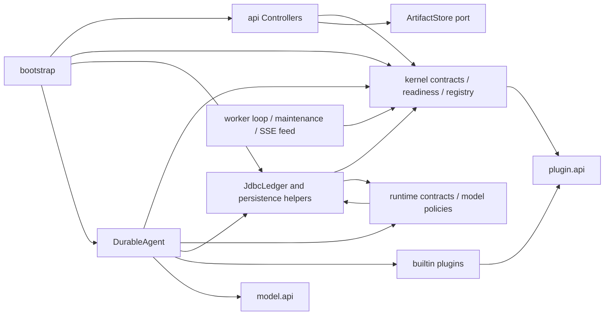
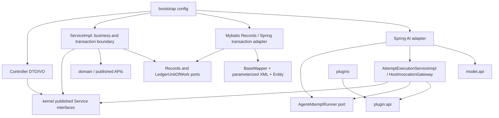

# 全仓结构治理与 MyBatis-Plus 迁移方案

2026-10-23，XIAO-59；状态：**proposed，交父项 XIAO-58 核定，尚未启动 XIAO-60 实施**。

本方案采用单 Maven 制品、业务 Service 接口及 `service/impl`、无框架执行内核、MyBatis-Plus 业务持久层。重构必须迁移真实调用链，删除旧业务 JDBC 实现；不会靠增加依赖、转发壳或改包名完成验收。控制与 worker 两角色、插件契约和现有有界能力保留。

## 1. 基线和证据边界

| 项目 | 准确事实 |
| --- | --- |
| 仓库 / 目标分支 | `https://github.com/Love-XiaoPeng/Jimu.git` / `master` |
| 源码基线 | `620d5e0e5bfe7b5da530f10997936466159ba34f` |
| tree | `ef29f391b8355a7d693a48cefdcc379e35c32929` |
| 前置验收 | XIAO-55，PR #20；验收源码 `dfed9348065123ea1b6634425f85ecbd6cc54572`，相同 tree |
| 前置 JAR | SHA256 `4e0a485e997354197f625999d0836b7c75087666bedd678a8f90fe20aab6cb5e`，本轮没有重新验收该 JAR |
| 事实来源 | XIAO-55 评论 `01a16847-f2be-77a2-a759-b68614bcd7c9`（独审）、`01a1684d-2d67-758f-9537-333d477eadd2`（QA）、`01a16851-bf8f-712f-a70d-005e855ad66a`（验收/合并）；XIAO-58/59 当前正文 |

初次 checkout 来自旧缓存 `d6d2d28…`，工作树无改动；通过现有本机代理单命令 fetch 后 fast-forward 到上述基线，并以 `ls-remote` 独立核对。没有重置、覆盖他人改动或更改持久代理配置。小队配置实际读取 `updated_at=2026-10-23T08:57:00Z`，采用其 Java/协作基线；并非据历史个人岗位推测。总体方案0.3、工程规范0.2、既有 ADR 和冻结来源保持原字节。

本轮静态盘点覆盖 **1,287 个受管文件、163 个生产 Java 文件、27,685 行生产 Java、22 个 Flyway 迁移、35 张迁移管理表**。另有外部供应的 `jimu_provisioning_receipt`，不能冒充本仓库管理表。逐文件摘要、包及 import、DDL 和候选字面量见 [证据目录](../../verification/XIAO-59/README.md)。import 图没有包含所有全限定名与运行时调用；下图补充已读方法体，不能当成新的 ArchUnit 通过记录。

## 2. 全仓清单和真实依赖

| 目录/逻辑模块 | 当前内容和结论 |
| --- | --- |
| 根目录、`.mvn/` | 单 POM/Wrapper、AGENTS/CONTRIBUTING、格式/静态门禁；没有 Maven 子模块，保持单制品合理 |
| `bootstrap`（3 Java） | 双角色和 Bean 装配；`DurableConfiguration` 302行，需按配置职责拆分，仍不承载业务规则 |
| `api`（8） | 7个 Controller + 错误适配；MVC/SSE、严格 JSON/原始 body；无前端工程，无浏览器契约改造任务 |
| `kernel`（21） | task API 集中16个；plugin/readiness已有接口与实际实现，不能说全仓没有 Service 接口 |
| `plugin/api`（21）、`model/api`（2） | JDK叶子契约；公开插件不依赖宿主实现，保留 |
| `adapters/persistence`（11） | JDBC业务账本、记录、证明、序列化、成本混合；这是 MP 迁移主范围 |
| `adapters/ai/springai`（3） | 单 ToolCallingAdvisor、受控模型HTTP/快照转换；已有原生框架复用，需拆大类而非另建循环 |
| `adapters/runtime`（68） | contract 7、directory 4、events 1、health 2、http 2、identity 1、interaction 2、mcp 5、media 4、model 8、search 6、session 10、todo 2、web 8、worker 6；运行设施与业务投影/策略需分离 |
| `adapters/storage`（3） | 本地/安全图片/安全工作区存储，保留实际路径、CAS、许可和POSIX边界 |
| `plugins/builtin`（23） | interaction1、mcp3、session4、todo1、webfetch4、websearch1、workspace9；仅公开契约依赖的边界合理 |
| `src/main/resources` | `application.properties`，V1–V22，plugins/workspace/media/mcp/interaction/todo/directory/session-v1…v4及evaluation资源；冻结路径/字节不机械重排 |
| `src/test`、`tools` | 单测、契约、ArchUnit、真实私有MySQL/多JVM/HTTP/存储验证；工具是测试设施，不要求改成Java业务Mapper |
| `workers/search` | 许可、固定原生源/launcher、bundle重建；不改为MySQL检索或新增搜索产品 |
| `docs/baseline`、`docs/adr`、`docs/verification`、`tools/evaluation/frozen` | 规范/决策/历史证据和固定评测；原证据不改写，不将历史候选状态追认为实现验收 |
| `.github` | 已存在的流水线定义按成员停用决定保持，不运行/启用/重跑/等待CI |



`A/R -> P` 主要是 `Payloads`/成本/操作工具依赖，形成 **adapters 内部**双向耦合；不是已证明顶层包循环。现有 `PackageBoundariesTest.java:25,45,95` 已检查叶子、Controller禁止引用adapter、顶层无环和kernel跨模块API，故“Controller直接SQL”并非已证实问题。当前门禁不能禁止Controller调用 `ArtifactStore`，也不能识别adapter内部巨型业务层。

## 3. 已证实的问题、合理设计和差异

下列 Java 路径均相对 `src/main/java/io/github/lovexiaopeng/jimu/`；行号锁上述基线。

| 编号 | 文件/行号与已读事实 | 影响及处置 |
| --- | --- | --- |
| A01 | `api/TaskController.java:90,129,158` 能力组合、资源准入、预算策略；`219` 直接调用存储读取产物 | 不是纯HTTP适配；移至TaskService/ArtifactService，保留错误次序与状态码 |
| A02 | `adapters/persistence/JdbcLedger.java:33` 同时实现10个业务接口；8828行；`277,2192,2629,3334,5589,6505,8159` 多业务准入/提交 | SQL、业务和事务变更互相牵动；按用例所有者拆Service和Records/Mapper，原子操作保持一次事务 |
| A03 | `JdbcLedger.java:4530,5200,5614` 等 `SELECT *`，`ExecutionScopeBinding.java:53` 同样存在 | 行映射隐含字段集；改显式列/resultMap，保留派生live/deadline字段、所有租户/owner/fence条件 |
| A04 | `JdbcLedger.java:4186` 自定义JdbcTemplate同时计量、设置每条语句截止；`JdbcSessionRecords.java:192` 根据SQL前缀加正文长度约束 | 换Mapper后可能悄然丢限额；以声明的查询策略、ResultSet读取计量和deadline适配迁移，禁字符串前缀识别 |
| A05 | `JdbcSessionRecords.java:128,146,261,276` BODY/表白名单、metadata列发现及固定点；1730行 | 安全和配额规则混入数据库工具；拆账本投影/证明/清理/计量，完整迁移35表路径，见持久化方案 |
| A06 | `adapters/ai/springai/DurableAgent.java:242,554,752,821` 单advisor、Session、网关/工具分派在1236行内 | 分出执行用例、checkpoint转换、宿主调用网关；不能为每个工具建第二循环或改变冻结工具槽 |
| A07 | `JdbcLedger.java:45`、`JdbcSessionRecords.java:55`、`runtime/session/SessionScopeQueryBudget.java:10` 同步ThreadLocal；`SessionQueryDeadline.java:31` 驱动socket上下文 | 不是全局跨用户Map，但多隐式载体难审计；业务预算显式传QueryContext，唯一驱动ThreadLocal例外保留并严格finally清除，异步body前后传累计值 |
| A08 | `Tasks.java:59` 终态列表，`JdbcLedger.java:1529` 清理终态另有差异；Controller和SQL内重复状态/阈值 | 建语义枚举/兼容code和用途不同的状态集合；NEEDS_RECONCILIATION不能机械加入可清理集合 |
| A09 | `bootstrap/DurableConfiguration.java:67,75,154` DS、迁移、受信身份、敏感值装配；`ModelProfiles.java:79,144,180` 环境绑定和业务能力判定混合 | 拆配置绑定和纯策略；保留test-mode/paid=false、当前完整授权、secret引用和缺资源失败 |
| A10 | `runtime/worker/WorkerLoop.java:78,106` 边界日志含cause；`TaskErrors.java:54` 将所有IllegalStateException映成产物不可用 | 现有安全会话错误已修复，不能认定仍泄漏；新增精准异常分类、cause只进受限诊断，不对外返回SQL/正文；不扩大吞错 |
| R01 | `kernel/plugin/application/PluginRegistry.java:16` 不可变发现集及重复拒绝，`kernel/readiness/application/ReadinessService.java:22` 有实际规则 | 已有合理接口实现；只迁目录命名，不新增空Manager/BaseService |
| R02 | `JdbcLedger.java:5589,5784` 先候选再锁重验、run→budget→task、fence；`8656` 存储删除在DB事务外 | 保留；BaseMapper/事务注解本身不保证这些性质 |
| R03 | `DurableAgent.java:242,754` 复用ToolCallingAdvisor/DefaultToolCallingManager | 保留原生复用，不引入Graph、Redis、Milvus、broker或新服务；本批没有对应业务需求 |

源码扫描结果和主流分层原则不等于运行缺陷复现。历史锁竞争现场持锁者未知；本方案不宣称已排除长事务/锁环。原完整verify exit1、未穷举容量/授权排列和DNS/TLS边界保持。

## 4. 目标目录、接口与依赖方向

```text
src/main/java/io/github/lovexiaopeng/jimu/
  bootstrap/{config,properties}/             # Bean装配、校验绑定，无业务准入
  api/{task,session,todo,interaction,directory,readiness}/
    controller/                             # HTTP/SSE适配
    dto/                                    # 请求；类型/字节/重复字段严格解析
    vo/                                     # 保持公开字段/数组/原始JSON，不输出Entity
  api/common/                               # 错误/严格body/游标协议适配
  kernel/{task,execution,worker,invocation,budget,artifact,event,identity,
          session,todo,interaction,directory,media,mcp,search,model,plugin,readiness}/
    api/                                    # 发布的命令/值对象/事件
    service/XxxService.java                  # 发布用例接口
    service/impl/XxxServiceImpl.java          # 有实际业务规则/事务编排的纯Java实现
    domain/                                 # 状态/策略/不变量；按需要创建
    port/                                   # 实际外部能力：Records、存储、模型配置、事务
  kernel/transaction/port/LedgerUnitOfWork.java
  kernel/shared/api/                         # 稳定错误及少数共享值，不造万能Context
  execution/{service,service/impl}/          # 执行一个attempt、宿主网关
  execution/port/AgentAttemptRunner.java    # 一次attempt的AI驱动能力，适配器实现
  plugin/api/                               # JDK叶子，已发布契约保持
  model/api/                                # JDK叶子，快照字段/版本保持
  plugins/builtin/                           # 薄插件与输入输出，不见Mapper/ServiceImpl
  adapters/persistence/<业务>/
    mapper/XxxMapper.java                    # BaseMapper + 明确参数方法
    entity/XxxEntity.java                    # 仅数据库列，不直接返回HTTP/模型
    projection/                             # 联查/锁查询的显式投影
    convert/                                # Entity与内核类型的必要转换
    MybatisXxxRecords.java                   # 实现对应Records端口，不承载业务准入
  adapters/persistence/{transaction,query,infrastructure}/
  adapters/codec/                            # 原Payloads，冻结快照编码/摘要/兼容mixins
  adapters/ai/springai/                       # 单advisor装配、ChatModel边界和消息转换
  adapters/runtime/                         # HTTP/进程/MCP/DNS等真实运行设施
  adapters/storage/                         # 安全本地文件能力
src/main/resources/mapper/<业务>/*Mapper.xml
```

目录树是职责位置，**不要求为每包创建空DTO/VO/port**。普通只读用例复用同模块Service接口，不额外包一个仅转发的应用层。Mapper/Entity只在持久适配器内部；与数据库列等同的独立领域对象不机械复制，只有进入内核/公开契约才转换。



调用经过接口，依赖箭头表示代码引用而非数据库调用方向。ServiceImpl不用Spring/SQL/MyBatis类型；一个真实的 `LedgerUnitOfWork` 端口承担同库事务、deadline、提交后失效记录和特殊拒绝后提交，适配器直接复用Spring TransactionTemplate。保留无框架kernel，避免仅为 `@Transactional` 修改整个内核依赖方向。普通业务方法的事务也由此统一实现，不逐Service创建事务管理器。若未来改用注解，必须另定kernel边界并处理final类/自调用代理问题，不能只补注解宣称有事务。

跨业务只调用对方发布 `service` 接口或 `api` 值，不引用 `impl/domain/port`；跨聚合原子提交由操作所有者在一个UoW内协调本身所需的Records端口，不调用多个各自独立提交的Service。Records是数据访问能力边界，不成为公共业务服务或通用SQL执行器。

### 用例所有者和旧新映射

完整163文件处理记录见 [file-mapping.json](../../verification/XIAO-59/evidence/file-mapping.json)；以下展开一对多迁移。文件拆分同时更新调用/测试import，不保留一套旧JDBC业务路径。

| 旧位置/锚点 | 目标所有者/位置 | 原子边界或职责 |
| --- | --- | --- |
| `api/TaskController:90–179`、`JdbcLedger:4599` | `kernel/task/service/TaskService` + `impl/TaskServiceImpl`，`TaskAdmissionPolicy` | 受理去重、能力/资源/预算、授权、pins、所有投影预留同事务；HTTP只解析/传递受信identity |
| `TaskController:215`、`JdbcLedger:5483,8029,8159,8251` | `kernel/artifact/service/ArtifactService` + impl | 下载核权和存储读取；分阶段stage→verify→publish，present与invocation结果/账本提交仍原子 |
| `JdbcLedger:5589,6202,8498,8560` | `kernel/worker/service/WorkerService` + impl | claim/续租/静止/进程收据；保留候选重验、SKIP LOCKED和唯一fence |
| `JdbcLedger:6214,6505,8350,8427` | `kernel/execution/service/ExecutionService` + impl | checkpoint/步骤事实/任务收尾；不在事务内调用模型或进程 |
| `JdbcLedger:6622,6767,7089,7192` | `kernel/model/service/ModelDispatchService` + impl，`kernel/budget/domain/ModelCosts` | dispatch、预留、usage和费用结算同事务；UNKNOWN不释放，不新增provider重试 |
| `JdbcLedger:7247,7487,7583,8227` | `kernel/invocation/service/InvocationService` + impl | 宿主准入、固定槽、提交、unknown；业务插件不能自行写终态 |
| `JdbcLedger:277,335,410,685,731,943,1124,1323` | `kernel/session/service/{SessionHistoryService,SessionScopeService}` + impl | v1–v4公开/模型入口、整个scope复核、切点/证明/重放；复用同一个session UoW策略 |
| `JdbcSessionRecords:276,689,951,1345` | `SessionAccounting`、`SessionReadProof`、`SessionHistoryServiceImpl`；SQL到Session Mapper | 计账/证明是业务，不留在SQL仓储；动态正文用窄Codec端口，不向kernel传播Jackson树 |
| `JdbcLedger:1951,2129,2192,2342` | `kernel/directory/service/WorkingDirectoryService` + impl | 目录slot冻结、真实观测与提交；FS等待在事务外，原路径绑定不变 |
| `JdbcLedger:2629,2819` | `kernel/todo/service/TodoService` + impl | replaceOrResult、读取、revision/CAS、一次消费，不以saveOrUpdate替代 |
| `JdbcLedger:3251,3318,3334,3511,3720` | `kernel/interaction/service/UserQuestionService` + impl | authorize-before-parse、幂等答复、暂停/恢复/late receipt，同原事务 |
| `JdbcLedger:3811–4119`、`JdbcMcpRecords` | `kernel/mcp/service/McpService` + impl；McpRecords/Mapper | 服务器/pin和cursor/计账；网络只在McpRuntime |
| `JdbcLedger:4258–4341`、`JdbcImageRecords` | `kernel/media/service/ImageService` + impl；MediaRecords/Mapper | 原图/normalized/checkpoint引用、真实副本费用；解码仍ImageNormalizer |
| `JdbcLedger:7613–7848` | `kernel/search/service/NativeSearchService` + impl；SearchRecords/Mapper | 准入/运行/停止证明、cursor/清理；NativeRunner继续唯一ProcessBuilder位置 |
| `JdbcLedger:1548,1627,1686,2980,3104,8656` | 各模块Service内明确cleanup用例；`LedgerMaintenance`只调这些用例 | 原安全静止和释放一次不变量；不建万能CleanupManager；文件删除在标记与结算事务之间 |
| `ExecutionScopeBinding:41`、`JdbcExecutionScopes:127`、`WebFetchReconciliation:25` | `kernel/model/service/{ExecutionScopeService,WebFetchAssessmentService}` + impl / Mapper | 运维绑定和只读评估也迁Mapper；权限账号与受理入口隔离，不由启动自动绑定 |
| `DurableAgent:174,458,554,752,821` | `execution/service/{AttemptExecutionService,HostInvocationGateway}`、`impl`；`CheckpointCodec`/`SpringAiSession`在adapter | 每次attempt的显式状态；一个advisor，admit→执行→提交，恢复不重新选择槽 |
| `Payloads`、`WebFetchReceipts`、`ModelProfiles` | `adapters/codec`；证明规则到内核，用窄codec端口；配置绑定到bootstrap，策略到model/domain | 去除runtime→persistence工具依赖；快照不带新Java类名，旧mixins和字段保持 |
| `ReadinessService`、`PluginRegistry` | `kernel/readiness/service/impl/ReadinessServiceImpl`、`kernel/plugin/service/impl/PluginCatalogServiceImpl`，沿已有接口语义 | 有实际规则；接口迁 `service`，不再叠加application转发层 |

`SecureWorkspaceStore` 813行含安全路径/CAS/原子文件语义，行数本身不是拆分理由。仅抽出已混合的路径解析/观测收据纯函数，保持同一安全存储入口，不分出绕过CAS的“快速写”。ImageNormalizer、McpWire、NativeRunner继续承担各自真实边界，不按行数阈值机械拆类。

### AI拆分的实际调用链

`WorkerLoop → AttemptExecutionService → AttemptExecutionServiceImpl → AgentAttemptRunner`。最后一个是执行层的窄端口，由 `SpringAiAttemptRunner` 实现；内核/执行实现不导入ChatClient、Advisor或adapter。AttemptExecutionServiceImpl负责lease/恢复输入选择、attempt开始/结束及取消/unknown收尾，通过发布的Execution/Model等Service完成账本用例。它每次attempt只调用一次runner，不再执行第二套工具选择循环。

SpringAiAttemptRunner创建本次attempt专属 `SpringAiSession`，沿原ToolCallingAdvisor驱动模型/工具循环；工具回调只通过 `HostInvocationGateway` 发布接口执行接纳、固定槽复用、外部操作和提交。HostInvocationGatewayImpl调用对应业务Service和明确宿主能力端口，不调用具体Spring AI或Mapper。快照转换走CheckpointCodec；session的lease、step、槽、取消信号和累计资源显式属于AttemptContext，结束后释放，不存全局Map/跨请求ThreadLocal。适配器只依赖执行接口/端口，bootstrap绑定二者；不产生execution→adapters源码反向引用。拆分后的恢复输入和未知结果处理须由V04/V06实测，不能以端口形状代替行为证明。

## 5. 持久化、魔法值、交付批次和验收

- [持久化迁移明细](persistence.md)：版本/装配、35表映射、事务/锁/复合键、资源计量、基础设施例外和回退。
- [业务值治理](magic-values.md)：枚举/常量/配置归属、单位/默认值/校验/冻结策略。
- [分批实施与必要验证](delivery-and-validation.md)：单写入者、初级切片、冲突文件、完成标准、真实回归矩阵和证据继承。
- [工程规范补充](../../engineering.md) 和 [ADR-0015](../../adr/0015-business-services-and-mybatis-plus.md)：本提案通过后的实施规则，不替代XIAO-58代码验收。

本轮仅做文档及隔离依赖/装配核查；没有产品源码/POM/DDL变更，没有新产品JAR，没有真实MySQL或业务回归结论。后续由产品经理核定范围并激活既有XIAO-60；本项不派工、不激活实现，也不启动T48或其他新功能。
